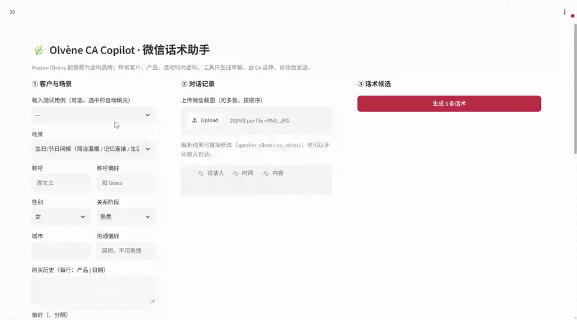

# Olvène CA Copilot

An AI tool that drafts three on-brand Chinese WeChat messages (话术) for luxury Client Advisors (CAs), across six scenarios: birthday and festive greetings, product recommendation, post-purchase care, reactivation, event invitation, and price objection. The CA picks one, edits it if needed, and sends it; the tool never sends anything.

> Applied AI Engineer written challenge · submitted 2026-11-09.
> The brand **Maison Olvène 欧薇恩** and all products, boutiques, events and clients in this repository are fictional.

## Demo

[](submission/assets/demo.mp4)

https://github.com/user-attachments/assets/b1bd5707-230b-4cea-80a8-1e949c4d28b4

28-second recording of the live app ([MP4](submission/assets/demo.mp4)): load test case S1-02, generate three candidate messages, choose one, then regenerate. The model's generation time is shortened: the middle of each wait is cut and the rest plays at 4×; other parts play at 1.5–3×.

## Submission

| Part | File | What it contains |
|---|---|---|
| A. Work log | [`submission/A_worklog.md`](submission/A_worklog.md) | Every step from reading the brief to the final result: what I did, input, output, AI tool used, screenshots |
| B. Methodology | [`submission/B_methodology.md`](submission/B_methodology.md) | Brand assumptions, tool design, how the test set was built, how results were evaluated, what "good" and "not acceptable" mean |
| C. 50 test cases | [`submission/C_test_cases.xlsx`](submission/C_test_cases.xlsx) · [`.md`](submission/C_test_cases.md) | Input and the three outputs of the final tool for every case, in the brief's columns |
| D. Evaluation report | [`submission/D_evaluation.md`](submission/D_evaluation.md) | Results by metric and scenario, best and worst examples, judge reliability, charts |
| E. Defects and next steps | [`submission/E_defects.md`](submission/E_defects.md) | Defects found with root cause, fix and before/after; what remains to fine-tune; next steps for production |
| Bonus: architecture | [`submission/architecture.md`](submission/architecture.md) | Deployment, pipeline and evaluation loop diagrams |

| | |
|---|---|
| Live demo | https://olvene-copilot-83224434541.us-central1.run.app — pick a test case at the top left, then 生成 3 条话术 (about 40 s). If it does not open from mainland China, please see the recording |
| Recording | [`submission/assets/demo.mp4`](submission/assets/demo.mp4): loading a test case, generating three candidates, choosing one and regenerating in the live demo (28 s; part of each generation wait is cut and the rest plays at 4×, other parts at 1.5–3×) |
| Brand assumptions | [`brand/brand_guide.md`](brand/brand_guide.md) (voice, red lines, scenario playbooks), [`brand/catalog.yaml`](brand/catalog.yaml) (products, services, events) |
| Test set | [`eval/cases/cases.yaml`](eval/cases/cases.yaml) and the rendered WeChat screenshots in [`eval/cases/screenshots/`](eval/cases/screenshots/) |
| Raw results | [`eval/results/final.jsonl`](eval/results/final.jsonl): every flag, score, judge comment and latency |

**Key results** of the final tool on all 50 cases (150 messages), details in [D](submission/D_evaluation.md):

| Rule violations after the tool's own checks | Unacceptable | Send-ready (judge) | Mean score (1–5) | Screenshot parsing | Median latency |
|---|---|---|---|---|---|
| 0% | 2% (one case, accepted on human review) | 90% | 4.19 | 100% of turns | 41 s |

**Versions**

| Version | What it is |
|---|---|
| v1 | First complete pipeline (prompts v1, brand guide v1.0). Used only as the "before" in E |
| **v2 (final)** | After two rounds of fixes from human review: brand guide v1.1, prompts v2, conversation state computed in code, WeChat voice-to-text, new rule checks. All results in C and D come from this version, and it runs in the live demo |
| judge j1 / j2 | LLM judge versions (B3). D uses j2; j1 was replaced because it rated everything send-ready (E1) |

## Repository layout

| Path | What it is |
|---|---|
| `submission/` | Deliverables A–E, the architecture and the charts used in D |
| `brand/` | Fictional brand foundation (inputs to the tool) |
| `eval/cases/` | The 50 test cases (`cases.yaml`) and their WeChat-style chat screenshots |
| `eval/results/` | Every evaluation run, reports, human review notes; `final.jsonl` is the submitted result |
| `archive/` | Early draft of the test set, superseded by `eval/cases/` |

## Code

| Path | Purpose |
|---|---|
| `brand/` | Brand guide (voice, red lines, playbooks, few-shot examples), machine-checkable rules, catalog (the only allowed source of product and event facts), festival calendar |
| `api/` | FastAPI service and the four-step pipeline (`api/pipeline/`), versioned prompts (`api/prompts/v1/`, `v2/`), CLI |
| `web/` | Streamlit UI for CAs |
| `eval/` | 50 test cases, WeChat screenshot renderer, batch runner, LLM judge, report, human-review agreement |
| `tests/` | Rule-checker tests against the brand guide examples, mock-mode end-to-end tests |
| `submission/architecture.md` | Architecture: deployment, pipeline, evaluation loop |

## Run locally

```bash
python -m venv .venv && .venv/bin/pip install -r requirements-dev.txt

# Offline (no credentials): deterministic mock LLM, for plumbing and UI
LLM_MODE=mock .venv/bin/python -m pytest -q
LLM_MODE=mock .venv/bin/streamlit run web/app.py

# Real Gemini on Vertex AI
gcloud auth application-default login
export GOOGLE_CLOUD_PROJECT=<project> GOOGLE_CLOUD_LOCATION=global
.venv/bin/python -m api.cli eval/cases/cases.yaml S6-02          # one test case
.venv/bin/uvicorn api.main:app --reload                          # API on :8000
.venv/bin/streamlit run web/app.py                               # UI, runs pipeline in-process
```

Environment variables: `GEN_MODEL` (default `gemini-3.1-pro-preview`), `FAST_MODEL` / `JUDGE_MODEL` (default `gemini-3-flash-preview`), `GOOGLE_CLOUD_LOCATION` (default `global`), `GEN_THINKING` / `FAST_THINKING`, `GEN_TEMPERATURE`, `MAX_REWRITES`, `LLM_REVIEW=0|1`, `PROMPT_VERSION` (default `v2`), `LOG_DIR`, `API_URL` (UI → API), `REQUIRE_LOGIN`, `QUOTA_BACKEND`.

## Evaluate

```bash
.venv/bin/python -m eval.render_wechat                       # (re)render screenshots for cases with a `screenshot` block
.venv/bin/python -m eval.run_eval --version v2               # 50 cases → eval/results/v2.{jsonl,csv,xlsx}, judged
.venv/bin/python -m eval.run_eval --version v2b --only S2-06,S6-03   # re-run selected cases
.venv/bin/python -m eval.run_eval --rejudge v1 --version v1_j2      # re-score old outputs with the current judge
.venv/bin/python -m eval.finalize v2 v2.1_partial            # merge runs → final.jsonl, export section C
.venv/bin/python -m eval.report v1_j2 final                  # summary tables, charts, worst-10, red-line list
.venv/bin/python -m eval.human_review sample final           # 15-case sheet to score by hand, then: agree final
```

## Deploy (Cloud Run)

```bash
PROJECT=<project>; REGION=us-central1
gcloud services enable run.googleapis.com aiplatform.googleapis.com artifactregistry.googleapis.com cloudbuild.googleapis.com
gcloud artifacts repositories create olvene --repository-format docker --location $REGION
gcloud iam service-accounts create huashu-sa
gcloud projects add-iam-policy-binding $PROJECT --role roles/aiplatform.user \
  --member serviceAccount:huashu-sa@$PROJECT.iam.gserviceaccount.com
gcloud storage buckets create gs://$PROJECT-olvene-eval --location $REGION
# web: Google sign-in + daily caps (counters in Firestore)
gcloud services enable firestore.googleapis.com secretmanager.googleapis.com
gcloud firestore databases create --location $REGION
gcloud projects add-iam-policy-binding $PROJECT --role roles/datastore.user \
  --member serviceAccount:huashu-sa@$PROJECT.iam.gserviceaccount.com
# OAuth client (console only): Google Auth Platform → Clients → Web application,
# redirect URI https://olvene-copilot-<PROJECT_NUMBER>.$REGION.run.app/oauth2callback; publish the app (In production).
# Fill .streamlit/secrets.toml.example, then:
gcloud secrets create olvene-web-auth --data-file .streamlit/secrets.toml
gcloud secrets add-iam-policy-binding olvene-web-auth --role roles/secretmanager.secretAccessor \
  --member serviceAccount:huashu-sa@$PROJECT.iam.gserviceaccount.com
gcloud storage buckets add-iam-policy-binding gs://$PROJECT-olvene-eval --role roles/storage.objectAdmin \
  --member serviceAccount:huashu-sa@$PROJECT.iam.gserviceaccount.com
gcloud builds submit --config cloudbuild.yaml --substitutions _REGION=$REGION
gcloud run jobs execute huashu-eval --region $REGION --args="--version,v1"
```

The build deploys `huashu-api` (private), `olvene-copilot` (public, calls the API with its service account's ID token) and the `huashu-eval` job (results go to the mounted GCS bucket). The Cloud Build service account needs `run.admin` and `iam.serviceAccountUser`.
