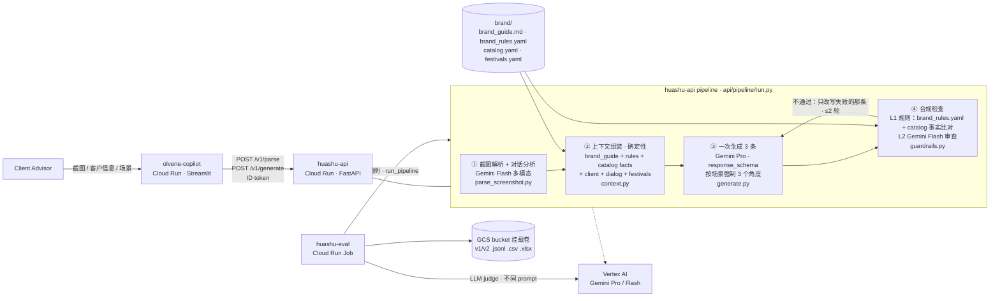

# Architecture

One container image with three roles on Cloud Run. Gemini runs on Vertex AI. Brand knowledge is loaded by key, with no vector retrieval (see 方案规划 §6).

| Component | Code | Notes |
|---|---|---|
| API | `api/main.py` | `/v1/parse` lets the CA correct the parsed dialog before generating. `/v1/generate` runs the full pipeline. |
| ① Parse | `api/pipeline/parse_screenshot.py`, `api/prompts/v1/parse_system.md` | Bubble colour and side give the speaker. Also extracts sentiment, refusals and open questions. Accepts screenshots, plain text or a pre-structured dialog. |
| ② Context | `api/pipeline/context.py` | Takes product facts from `catalog.yaml` only. Switches to care/restraint angles when the client is negative or has refused. |
| ③ Generate | `api/pipeline/generate.py`, `api/prompts/v1/generate_*.md` | One call returns three candidates, one per angle (`api/schemas.py: SCENARIO_ANGLES`). |
| ④ Guardrails | `api/pipeline/guardrails.py` | **L1:** forbidden phrases and regexes, discount wording outside refusals, length, punctuation, emoji, gender and salutation, prices against facts, event date and time against the catalog, scenario rules, pairwise similarity. **L2:** an LLM reviewer checks for fabrication, pushiness, ignored questions and tone. |
| UI | `web/app.py` | Calls the API over HTTP when `API_URL` is set. Otherwise runs the pipeline in-process. |
| Eval | `eval/run_eval.py`, `eval/judge.py`, `eval/report.py`, `eval/human_review.py` | Results are tagged with `prompt_version` and `brand_version`. |
| Test data | `eval/cases/cases.yaml`, `eval/render_wechat.py` | 50 fictional cases. Screenshots are rendered with Pillow. |
