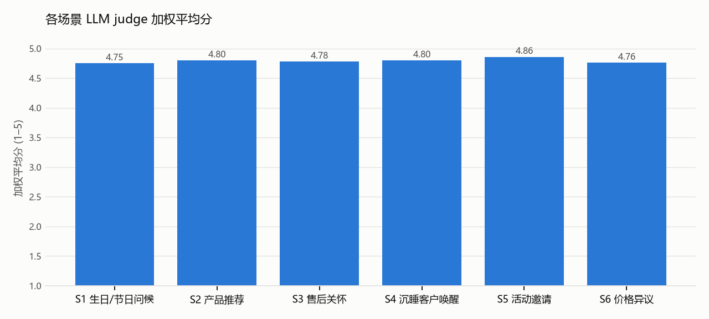

# Evaluation report · v1

## D1. Summary

| Metric | v1 |
|---|---|
| Cases (errors) | 50 (0) |
| Hard-fail rate (messages, L1 after rewrites) | 0% |
| Cases with ≥ 1 hard fail | 0 |
| Unacceptable rate (L1 or judge red line) | 0% |
| Good rate | 98% |
| Send-ready rate (judge) | 100% |
| Mean weighted score | 4.79 |
| Mean diversity (set, 1–5) | 4.98 |
| Mean max pairwise similarity | 0.39 |
| Screenshot parse recall | 100% |
| Mean rewrites per case | 0.64 |
| Median latency per case (ms) | 44445 |

## D2. By scenario · v1

| Scenario | Hard-fail | Unacceptable | Good | personalisation | on_brand | timing | naturalness | cta | Diversity | Weighted |
|---|---|---|---|---|---|---|---|---|---|---|
| S1 生日/节日问候 | 0% | 0% | 92% | 4.25 | 4.83 | 4.92 | 4.96 | 5 | 5 | 4.75 |
| S2 产品推荐 | 0% | 0% | 100% | 4.52 | 4.93 | 5 | 4.74 | 4.89 | 5 | 4.8 |
| S3 售后关怀 | 0% | 0% | 100% | 4.5 | 4.75 | 5 | 4.92 | 4.88 | 4.88 | 4.78 |
| S4 沉睡客户唤醒 | 0% | 0% | 96% | 4.5 | 4.92 | 4.96 | 4.96 | 4.67 | 5 | 4.8 |
| S5 活动邀请 | 0% | 0% | 100% | 4.54 | 4.92 | 5 | 5 | 5 | 5 | 4.86 |
| S6 价格异议 | 0% | 0% | 100% | 4.33 | 4.85 | 4.93 | 4.89 | 4.96 | 5 | 4.76 |

## Hard-fail and red-line list · v1

## Lowest-scoring 10 messages · v1

- **S4-02 #3** (3.9) 纯问候角度，虽然使用了客户细节，但相比候选0略显平淡。署名Kevin在熟悉关系中略显生硬，但作为久未联系的唤醒是可以接受的。  
  > 谢女士，最近好吗。北京这几天降温明显，出门记得多穿点。刚才翻到咱们以前的聊天，想起您说那只酒红色的沙漏包背着很顺手。我是Kevin，冬天到了，简单给您问个好。
- **S6-08 #2** (4.0) 利用了客户“说话直接”的特点进行同频沟通，显得真诚。提到已购产品皮带的保养服务是一个很好的关系维护动作，有效地缓和了价格异议带来的尴尬，体现了品牌的服务价值。  
  > 钟先生，您的语音我听了。您一向说话直接，我也跟您说实话。这只旅程旅行袋定在这个价格，主要因为工艺上能在符合登机尺寸的同时比全皮减轻百分之四十的重量。加上全国统一的定价政策，确实没有任何折扣空间。您之前买的那条经纬皮带平时如果有需要护理的地方，随时拿来店里我帮您做基础保养，买包的事咱们以后再说。
- **S4-03 #3** (4.15) 纯问候角度，虽然没有提及具体产品细节，但作为唤醒第一步非常安全，体现了品牌‘温润’的特质。  
  > 朱先生，近来好吗。我是欧薇恩成都店的Amy。成都这两天接连降温，发个消息简单问候一声。天冷出门记得多添件厚外套，之后有任何需要随时找我。
- **S2-02 #2** (4.2) 通过客户购买过的皮带系列进行关联，体现了CA的细心。工艺描述准确，但相比候选0，在生活关怀感上略逊一筹。  
  > 王先生，收到您的留言。为您母亲挑选一万元左右的生日礼物，我很推荐经纬披肩140，价格是九千八百元。您之前选过的皮带也是经纬系列，这款披肩采用手工丝网印刷工艺，流苏全手工制作，真丝加羊绒材质非常有质感。送给长辈既贴心又有分量，您觉得可以吗？
- **S1-02 #1** (4.25) 非常得体且克制，符合初识阶段的礼貌边界。虽然个性化细节较少，但将生日与元旦结合得自然，无推销，符合品牌温润的调性。  
  > 许女士，明天是您的生日，刚好也是新年的第一天。祝您生日快乐，新年平安顺遂✨
- **S1-02 #2** (4.3) 准确引用了客户唯一的购买记录（金丝卡包），并以关心使用感受的方式切入，比纯祝福更具CA的职业感。语气自然，无施压。  
  > 许女士，提前祝您明天生日快乐🎂 之前您选的那只黑色金丝卡包，希望这几个月用着还顺手。新的一年就要到了，祝您每天都有好心情。
- **S1-03 #3** (4.3) 虽然提到了上个月购买的旅行袋，但属于售后关怀式的问候而非推销，结合了客户常年出差的背景，显得很贴心。  
  > David，祝您生日快乐🎂 上个月带去新加坡的旅行袋用着还顺手吧。常年出差辛苦，今天无论在哪，都记得给自己留点时间庆祝一下。
- **S1-06 #3** (4.3) 结合了地域气候和产品保养建议。虽然在节日问候中加入了保养提醒，但由于是免费服务且针对光面皮特性，显得很贴心而非推销。  
  > 吴女士，七夕快乐。北京立秋后早晚慢慢转凉，您出门可以备件薄外套。那只浅杏色索恩斜挎包平时若是留下轻微划痕，随时拿来店里我帮您做个基础护理。
- **S3-03 #3** (4.3) 虽然角度是搭配建议，但内容更偏向存放建议。提到了雾灰色的百搭性，符合客户偏好。语气克制，CTA自然。  
  > 冯女士，记得您那只雾灰色沙漏包几乎每天都在背。雾灰色很百搭，不管是日常休闲还是正式场合都能胜任。如果偶尔换包不用时，可以在包里塞些防尘纸存放。需要做基础保养随时找我。
- **S3-05 #2** (4.3) 加入了工艺细节（手工缝制），解释了产品特性但没有作为借口，态度诚恳。CTA明确，引导到店检查是标准的售后流程。  
  > 曹女士，很抱歉昨晚没能及时回复。看到照片了，这确实让人心里不舒服，非常抱歉让您失望了。这只卡包的金色缝线是手工缝制的，为了给您一个最妥善的答复，您近期随时可以把这只酒红色的卡包拿来上海门店，我帮您交给工坊做仔细的检查和维护，一定为您解决好。
