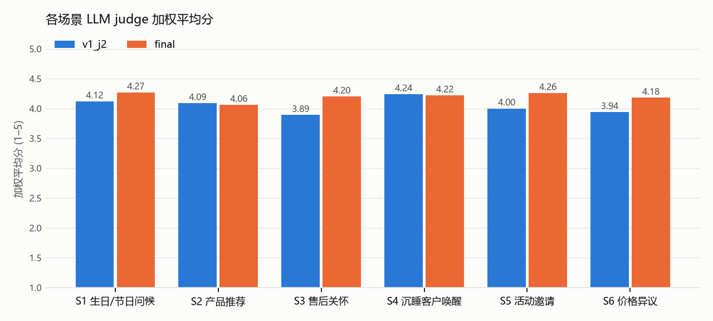

# Evaluation report · v1_j2 vs final

## D1. Summary

| Metric | v1_j2 | final |
|---|---|---|
| Cases (errors) | 50 (0) | 50 (0) |
| Hard-fail rate (messages, L1 after rewrites) | 0% | 0% |
| Cases with ≥ 1 hard fail | 0 | 0 |
| Unacceptable rate (L1 or judge red line) | 11% | 2% |
| Good rate | 46% | 60% |
| Send-ready rate (judge) | 59% | 90% |
| Mean weighted score | 4.05 | 4.19 |
| Mean diversity (set, 1–5) | 4.72 | 4.74 |
| Mean max pairwise similarity | 0.39 | 0.41 |
| Screenshot parse recall | 100% | 100% |
| Mean rewrites per case | 0.64 | 0.36 |
| Median latency per case (ms) | 44445 | 40992 |

## D2. By scenario · v1_j2

| Scenario | Hard-fail | Unacceptable | Good | personalisation | on_brand | timing | naturalness | cta | Diversity | Weighted |
|---|---|---|---|---|---|---|---|---|---|---|
| S1 生日/节日问候 | 0% | 17% | 50% | 3.92 | 3.88 | 4.29 | 4.08 | 4.96 | 5 | 4.12 |
| S2 产品推荐 | 0% | 11% | 56% | 3.85 | 4.22 | 4.15 | 3.93 | 4.52 | 4.89 | 4.09 |
| S3 售后关怀 | 0% | 25% | 46% | 3.83 | 3.83 | 3.88 | 3.75 | 4.5 | 4.25 | 3.89 |
| S4 沉睡客户唤醒 | 0% | 0% | 71% | 3.88 | 4.25 | 4.62 | 4.17 | 4.54 | 5 | 4.24 |
| S5 活动邀请 | 0% | 0% | 42% | 3.75 | 3.96 | 4 | 4.04 | 4.62 | 4.38 | 4.0 |
| S6 价格异议 | 0% | 11% | 15% | 3.74 | 4.3 | 3.41 | 3.85 | 4.81 | 4.78 | 3.94 |

## D2. By scenario · final

| Scenario | Hard-fail | Unacceptable | Good | personalisation | on_brand | timing | naturalness | cta | Diversity | Weighted |
|---|---|---|---|---|---|---|---|---|---|---|
| S1 生日/节日问候 | 0% | 0% | 42% | 3.42 | 4.33 | 4.75 | 4.46 | 4.88 | 4.75 | 4.27 |
| S2 产品推荐 | 0% | 11% | 59% | 3.63 | 4.15 | 4.26 | 4.11 | 4.44 | 4.67 | 4.06 |
| S3 售后关怀 | 0% | 0% | 71% | 3.83 | 4.21 | 4.5 | 4.21 | 4.5 | 4.75 | 4.2 |
| S4 沉睡客户唤醒 | 0% | 0% | 71% | 3.83 | 4.25 | 4.46 | 4.29 | 4.46 | 4.88 | 4.22 |
| S5 活动邀请 | 0% | 0% | 62% | 3.75 | 4.29 | 4.54 | 4.38 | 4.67 | 4.62 | 4.26 |
| S6 价格异议 | 0% | 0% | 56% | 3.63 | 4.33 | 4.33 | 4.19 | 4.81 | 4.78 | 4.18 |

## Hard-fail and red-line list · final

- **S2-02 #1** 提及母亲年龄（60大寿）  
  > 王先生，抱歉昨天没及时回复。阿姨下个月过60大寿，一万左右的预算，我很推荐经纬披肩140。它是羊绒和真丝混纺的，北京现在正好入冬，披着既保暖又轻盈，很适合长辈。它的价格是9800元，正好在您的预算内。您看这款作为礼物合适吗？
- **S2-02 #2** 提及母亲年龄（60大寿）  
  > 王先生，不好意思回复晚了。为您母亲挑60大寿的礼物，一万元左右的话，推荐您看看经纬披肩140。它是羊绒和真丝材质，上面的图案都是由匠人手工丝网印刷的，很有质感，作为长辈的寿礼非常有分量。这款价格是9800元。您觉得阿姨平时偏好什么色系？
- **S2-02 #3** 提及母亲年龄（60大寿）  
  > 王先生，抱歉昨天没来得及回您。阿姨60大寿的礼物，一万预算内，我觉得经纬披肩140特别合适，价格是9800元。这件是羊绒加真丝，现在有驼色、灰蓝和暮紫几个颜色，长辈用很提气色。我拍几张实物照片发给您看看感觉，可以吗？

## Lowest-scoring 10 messages · final

- **S2-02 #1** (2.4) 违反了不提年龄的红线。此外，直接说'正好在您的预算内'略显生硬，缺乏品牌的高级感。  
  > 王先生，抱歉昨天没及时回复。阿姨下个月过60大寿，一万左右的预算，我很推荐经纬披肩140。它是羊绒和真丝混纺的，北京现在正好入冬，披着既保暖又轻盈，很适合长辈。它的价格是9800元，正好在您的预算内。您看这款作为礼物合适吗？
- **S2-02 #2** (2.65) 违反了不提年龄的红线。工艺描述较为得体，但'非常有分量'的表述略显俗套。  
  > 王先生，不好意思回复晚了。为您母亲挑60大寿的礼物，一万元左右的话，推荐您看看经纬披肩140。它是羊绒和真丝材质，上面的图案都是由匠人手工丝网印刷的，很有质感，作为长辈的寿礼非常有分量。这款价格是9800元。您觉得阿姨平时偏好什么色系？
- **S4-03 #1** (3.0) 主要问题在于结尾直接要求到店，违反了沉睡唤醒场景‘不在第一条消息里要求到店’的禁忌。‘一下子想起了您’略显生硬，但结合陈列细节尚可。  
  > 朱先生，最近好吗？今天店里在陈列小皮具，看到焦糖棕色的金丝系列，一下子想起了您。不知道您那只钱夹现在用得还顺手吗？您要是有空，随时欢迎来成都店里转转。
- **S6-03 #2** (3.15) 未按照对话状态要求为回复晚了道歉。口吻比较真诚，解释了差价原因并提及了具体服务。  
  > 程女士，关于您之前问到的价格差异，我跟您说句实话。品牌是统一定价的，但因为各地的税费和汇率不同，确实会产生差价。国内专柜的价格里，其实包含了后续长期的服务，像您看中的那只焦糖棕沙漏包，以后随时可以拿来店里做免费的清洁保养，还能烫印您的名字。只是跟您说明一下情况，您完全可以按自己的节奏来考虑。
- **S2-02 #3** (3.2) 违反了不提年龄的红线。互动方式较好，通过拍照片引导下一步，压力较小。  
  > 王先生，抱歉昨天没来得及回您。阿姨60大寿的礼物，一万预算内，我觉得经纬披肩140特别合适，价格是9800元。这件是羊绒加真丝，现在有驼色、灰蓝和暮紫几个颜色，长辈用很提气色。我拍几张实物照片发给您看看感觉，可以吗？
- **S4-07 #3** (3.2) 主要问题是关怀略显啰嗦且带有指令感（“别太累”），且“喝杯热茶”的邀约对于半年未回复的初识客户来说略显突兀。品牌口吻稍显平淡。  
  > 马女士，最近一切都好吗？北京这几天降温明显，风也挺大的，您日常出行多添件厚衣服，注意防寒。年底这段时间往往比较忙碌，您也别太累。有空路过店里附近，随时欢迎进来喝杯热茶。
- **S6-03 #1** (3.25) 未按照对话状态要求为回复晚了道歉。优点是回应了代购差价的心理感受，且收尾的关心比较自然。  
  > 程女士，之前您提到代购价格的事，确实，八千的差价换作是我也会觉得疑惑。各地定价受税费和汇率影响，确实会有差异。我们在国内专柜购买，主要是多了一份长久的安心，比如免费的姓名烫印和终身的清洁保养服务。买东西最重要的是自己开心，无论您最后怎么选择，我都完全理解。最近成都降温了，注意保暖。
- **S2-05 #2** (3.3) 合格但略显生硬。列举颜色和提到预留服务虽然专业，但读起来稍微有点像销售话术，不如候选0温润。  
  > 孙女士，那天您提到想找一只轻便通勤、价格在三万以内的包，我帮您留意了。店里有一款索恩斜挎包 Saône 很符合您的需求。它是光面小牛皮材质，肩带可以调节长度，平时背着上下班很轻便。这只定价是两万七千八，目前有黑色、焦糖棕和浅杏色现货。如果刚好有您喜欢的颜色，我帮您预留四十八小时，您有空再来看看。
- **S3-01 #3** (3.4) “搭配您平时的常服会很清爽”略显空泛，且“常服”一词在微信语境下不够自然。相比前两条，这条消息的个性化程度较低。  
  > 钱小姐，这几天有背着那只沙漏包出门吗。奶白色的迷你款很适合周末出去逛街的时候背，搭配您平时的常服会很清爽。刚开始用有什么不顺手的地方，或者以后需要做皮具清洁，随时给我发消息就好。
- **S3-04 #3** (3.4) ‘在家里休息或者出门散步’的描述略显啰嗦，且对长辈的使用场景做了一定程度的预设（指令感），不如前两条干练。  
  > 韩先生，阿姨的披肩应该收到了吧。那条披肩尺寸宽大，阿姨在家里休息或者出门散步时随意披在肩上都很合适。希望它能陪阿姨度过一个温暖的冬天，有什么需要随时找我。
