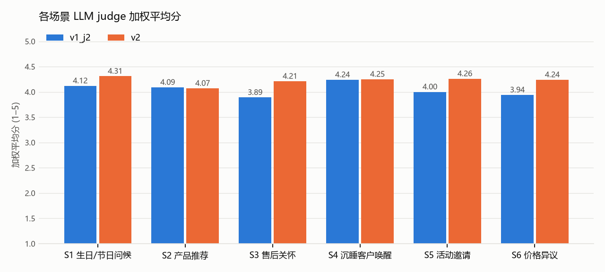

# Evaluation report · v1_j2 vs v2

## D1. Summary

| Metric | v1_j2 | v2 |
|---|---|---|
| Cases (errors) | 50 (0) | 50 (0) |
| Hard-fail rate (messages, L1 after rewrites) | 0% | 1% |
| Cases with ≥ 1 hard fail | 0 | 2 |
| Unacceptable rate (L1 or judge red line) | 11% | 7% |
| Good rate | 46% | 58% |
| Send-ready rate (judge) | 59% | 87% |
| Mean weighted score | 4.05 | 4.22 |
| Mean diversity (set, 1–5) | 4.72 | 4.72 |
| Mean max pairwise similarity | 0.39 | 0.42 |
| Screenshot parse recall | 100% | 100% |
| Mean rewrites per case | 0.64 | 0.48 |
| Median latency per case (ms) | 44445 | 41909 |

## D2. By scenario · v1_j2

| Scenario | Hard-fail | Unacceptable | Good | personalisation | on_brand | timing | naturalness | cta | Diversity | Weighted |
|---|---|---|---|---|---|---|---|---|---|---|
| S1 生日/节日问候 | 0% | 17% | 50% | 3.92 | 3.88 | 4.29 | 4.08 | 4.96 | 5 | 4.12 |
| S2 产品推荐 | 0% | 11% | 56% | 3.85 | 4.22 | 4.15 | 3.93 | 4.52 | 4.89 | 4.09 |
| S3 售后关怀 | 0% | 25% | 46% | 3.83 | 3.83 | 3.88 | 3.75 | 4.5 | 4.25 | 3.89 |
| S4 沉睡客户唤醒 | 0% | 0% | 71% | 3.88 | 4.25 | 4.62 | 4.17 | 4.54 | 5 | 4.24 |
| S5 活动邀请 | 0% | 0% | 42% | 3.75 | 3.96 | 4 | 4.04 | 4.62 | 4.38 | 4.0 |
| S6 价格异议 | 0% | 11% | 15% | 3.74 | 4.3 | 3.41 | 3.85 | 4.81 | 4.78 | 3.94 |

## D2. By scenario · v2

| Scenario | Hard-fail | Unacceptable | Good | personalisation | on_brand | timing | naturalness | cta | Diversity | Weighted |
|---|---|---|---|---|---|---|---|---|---|---|
| S1 生日/节日问候 | 0% | 0% | 50% | 3.54 | 4.33 | 4.79 | 4.46 | 4.88 | 4.75 | 4.31 |
| S2 产品推荐 | 0% | 22% | 52% | 3.67 | 4.15 | 4.22 | 4.11 | 4.52 | 4.56 | 4.07 |
| S3 售后关怀 | 0% | 0% | 75% | 3.88 | 4.21 | 4.58 | 4.12 | 4.5 | 4.75 | 4.21 |
| S4 沉睡客户唤醒 | 0% | 0% | 67% | 3.92 | 4.29 | 4.46 | 4.29 | 4.5 | 4.88 | 4.25 |
| S5 活动邀请 | 0% | 0% | 62% | 3.75 | 4.29 | 4.54 | 4.38 | 4.67 | 4.62 | 4.26 |
| S6 价格异议 | 7% | 18% | 44% | 3.56 | 4.37 | 4.56 | 4.37 | 4.78 | 4.78 | 4.24 |

## Hard-fail and red-line list · v2

- **S2-02 #1** 提及母亲年龄（60大寿）  
  > 王先生，抱歉昨天没及时回复。阿姨下个月过60大寿，一万左右的预算，我很推荐经纬披肩140。它是羊绒和真丝混纺的，北京现在正好入冬，披着既保暖又轻盈，很适合长辈。它的价格是9800元，正好在您的预算内。您看这款作为礼物合适吗？
- **S2-02 #2** 提及母亲年龄（60大寿）  
  > 王先生，不好意思回复晚了。为您母亲挑60大寿的礼物，一万元左右的话，推荐您看看经纬披肩140。它是羊绒和真丝材质，上面的图案都是由匠人手工丝网印刷的，很有质感，作为长辈的寿礼非常有分量。这款价格是9800元。您觉得阿姨平时偏好什么色系？
- **S2-02 #3** 提及母亲年龄（60大寿）  
  > 王先生，抱歉昨天没来得及回您。阿姨60大寿的礼物，一万预算内，我觉得经纬披肩140特别合适，价格是9800元。这件是羊绒加真丝，现在有驼色、灰蓝和暮紫几个颜色，长辈用很提气色。我拍几张实物照片发给您看看感觉，可以吗？
- **S2-06 #1** 声称听过语音、看过图片的具体内容（输入中只有 [语音]/[图片] 占位符）属于捏造  
  > Kevin，实在抱歉，这几天太忙漏回消息了。您的语音我现在不太方便听，不知道里面有没有提到具体的偏好？看您文字说需要天天 meeting，我觉得店里的黑色工坊公文包很适合您现在的新岗位。它是全粒面小牛皮材质，稳重体面，刚好能装下 15 英寸的笔记本。您先忙晋升后的事，想看实物了随时告诉我。
- **S2-06 #2** 声称听过语音、看过图片的具体内容（输入中只有 [语音]/[图片] 占位符）属于捏造  
  > Kevin，实在抱歉，这几天太忙漏回消息了。那条语音我现在不太方便听，不知道里面有没有提您的具体偏好？看您文字说要换个像样点的电脑包，我觉得工坊公文包很配您现在的身份。它是工匠用马鞍针法手工缝制的，内侧还留有专属的匠人编号，低调但经得起细看，带去开会特别压得住场。您先忙晋升这阵子的事，有兴趣的话我改天拍几张实物给您看看。
- **S2-06 #3** 声称听过语音、看过图片的具体内容（输入中只有 [语音]/[图片] 占位符）属于捏造  
  > Kevin，实在抱歉，这几天太忙漏回消息了。那条语音我这边暂时听不了，不知道您在里面有没有补充对包的具体要求？看到您文字说需要适合 meeting 的电脑包，我想到店里的黑色工坊公文包。全粒面小牛皮的质感很好，装 15 英寸笔记本也绰绰有余。我拍了一小段实物视频发给您，您可以先直观感受下细节。您先忙新岗位的事，空了看一眼就好。
- **S6-01 #3** discount_mention（「在价格上给到折扣」不是明确拒绝语境）  
  > 陆女士，抱歉昨天太晚没能及时回复。十分理解您的想法，四万六确实是一笔需要斟酌的预算。因为品牌一直执行全国统一定价，确实没办法在价格上给到折扣，这点也要跟您说实话。您可以再慢慢考量，完全不用有压力。以后您要是来附近逛街，随时欢迎再来店里试背。
- **S6-03 #1** 客户等了一天以上却没有为回复晚道歉或解释  
  > 程女士，非常理解您的顾虑，八千的差价确实不是个小数目，换作是我也会去比一比的。我们在国内专柜的价格是统一的，和海外相比，主要是受各地的税费和汇率影响，所以会有这样的差异。买东西最重要是自己心里觉得合适，您完全可以按照自己的节奏慢慢考虑，不用觉得有压力。
- **S6-03 #2** 客户等了一天以上却没有为回复晚道歉或解释  
  > 程女士，能理解您的想法，这中间的差价换谁都会比较一下。国内外定价受税费和汇率影响，确实存在差异，这点要跟您说实话。咱们国内专柜虽然没有折扣，但能为您这只焦糖棕沙漏包提供免费的姓名缩写烫印，以后的清洁和基础保养也是一直由我们负责。您可以综合对比一下，有需要随时找我。
- **S6-03 #3** 客户等了一天以上却没有为回复晚道歉或解释  
  > 程女士，看到您的消息了，完全理解您的疑问。各地因为税费和汇率的原因，价格上确实会有不小的差异。买包是为了哄自己开心，您怎么选最顺心就怎么来，千万别觉得有负担。那只焦糖棕的沙漏包中号店里目前有现货，如果您之后哪天想再来上身试背看看感觉，随时发信息给我。
- **S6-05 #2** emoji_count（表情 1 个，本条上限 0）  
  > 魏女士，很抱歉隔了一天才回复您。您的诚意我完全感受到了，我也很希望能把这只黑色沙漏包交到您手上。但品牌确实没有送赠品的政策，丝巾实在没办法送给您，这点要跟您坦白。知道您平时很喜欢丝巾，如果您之后有空来店里，我很乐意为您做一次丝巾系法教学，给您看看怎么搭配这只包更好看。您不用有压力，可以再慢慢考虑一下，有想法随时找我 🌿

## Lowest-scoring 10 messages · v2

- **S2-02 #1** (2.4) 违反了不提年龄的红线。此外，直接说'正好在您的预算内'略显生硬，缺乏品牌的高级感。  
  > 王先生，抱歉昨天没及时回复。阿姨下个月过60大寿，一万左右的预算，我很推荐经纬披肩140。它是羊绒和真丝混纺的，北京现在正好入冬，披着既保暖又轻盈，很适合长辈。它的价格是9800元，正好在您的预算内。您看这款作为礼物合适吗？
- **S2-02 #2** (2.65) 违反了不提年龄的红线。工艺描述较为得体，但'非常有分量'的表述略显俗套。  
  > 王先生，不好意思回复晚了。为您母亲挑60大寿的礼物，一万元左右的话，推荐您看看经纬披肩140。它是羊绒和真丝材质，上面的图案都是由匠人手工丝网印刷的，很有质感，作为长辈的寿礼非常有分量。这款价格是9800元。您觉得阿姨平时偏好什么色系？
- **S4-03 #1** (3.0) 主要问题在于结尾直接要求到店，违反了沉睡唤醒场景‘不在第一条消息里要求到店’的禁忌。‘一下子想起了您’略显生硬，但结合陈列细节尚可。  
  > 朱先生，最近好吗？今天店里在陈列小皮具，看到焦糖棕色的金丝系列，一下子想起了您。不知道您那只钱夹现在用得还顺手吗？您要是有空，随时欢迎来成都店里转转。
- **S2-02 #3** (3.2) 违反了不提年龄的红线。互动方式较好，通过拍照片引导下一步，压力较小。  
  > 王先生，抱歉昨天没来得及回您。阿姨60大寿的礼物，一万预算内，我觉得经纬披肩140特别合适，价格是9800元。这件是羊绒加真丝，现在有驼色、灰蓝和暮紫几个颜色，长辈用很提气色。我拍几张实物照片发给您看看感觉，可以吗？
- **S4-07 #3** (3.2) 主要问题是关怀略显啰嗦且带有指令感（“别太累”），且“喝杯热茶”的邀约对于半年未回复的初识客户来说略显突兀。品牌口吻稍显平淡。  
  > 马女士，最近一切都好吗？北京这几天降温明显，风也挺大的，您日常出行多添件厚衣服，注意防寒。年底这段时间往往比较忙碌，您也别太累。有空路过店里附近，随时欢迎进来喝杯热茶。
- **S2-05 #2** (3.3) 合格但略显生硬。列举颜色和提到预留服务虽然专业，但读起来稍微有点像销售话术，不如候选0温润。  
  > 孙女士，那天您提到想找一只轻便通勤、价格在三万以内的包，我帮您留意了。店里有一款索恩斜挎包 Saône 很符合您的需求。它是光面小牛皮材质，肩带可以调节长度，平时背着上下班很轻便。这只定价是两万七千八，目前有黑色、焦糖棕和浅杏色现货。如果刚好有您喜欢的颜色，我帮您预留四十八小时，您有空再来看看。
- **S3-05 #2** (3.3) 合格。相比候选0，这条消息在回应情绪上略显单薄，更偏向于解决问题的流程说明，但依然得体且符合品牌规范。  
  > 曹女士，实在抱歉昨晚没及时回复您的消息。照片我仔细看了，给您带来这么糟糕的体验真的非常抱歉。对于起毛的情况，最妥当的办法是安排工坊师傅做个专业的检测和修复。您看最近是否方便抽空把卡包带来店里？等师傅看到实物确认了具体情况，我会第一时间跟您同步处理方案，一定帮您解决好。
- **S3-01 #3** (3.4) “搭配您平时的常服会很清爽”略显空泛，且“常服”一词在微信语境下不够自然。相比前两条，这条消息的个性化程度较低。  
  > 钱小姐，这几天有背着那只沙漏包出门吗。奶白色的迷你款很适合周末出去逛街的时候背，搭配您平时的常服会很清爽。刚开始用有什么不顺手的地方，或者以后需要做皮具清洁，随时给我发消息就好。
- **S3-04 #3** (3.4) ‘在家里休息或者出门散步’的描述略显啰嗦，且对长辈的使用场景做了一定程度的预设（指令感），不如前两条干练。  
  > 韩先生，阿姨的披肩应该收到了吧。那条披肩尺寸宽大，阿姨在家里休息或者出门散步时随意披在肩上都很合适。希望它能陪阿姨度过一个温暖的冬天，有什么需要随时找我。
- **S2-09 #2** (3.45) 中规中矩。虽然提到了工艺，但相比候选0，对客户“不撞款”这一核心诉求的回应略显单薄。语气稍显正式，不如候选0亲切。  
  > 罗女士，关于您的十周年礼物，我有个提议。想要真正有纪念意义，不如考虑我们的 Sur Mesure 定制服务。这只包可以由您亲自挑选皮料和内衬，再交由匠人全程手工制作完成。因为工期需要5到7个月，现在开始筹备刚好能赶上明年五一。您哪天方便来一趟，我们一起聊聊您的设计想法？
