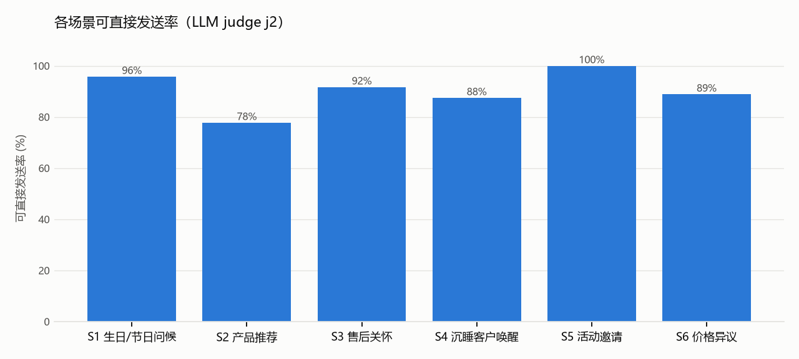
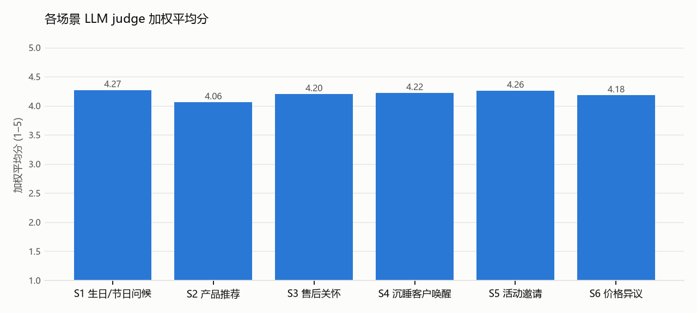

# D. Evaluation report

Results of the final tool (v2) on all 50 test cases. Generation uses Gemini 3.1 Pro; screenshot reading, review and judging use Gemini 3 Flash, all on Vertex AI. Method and grade definitions are in [`B_methodology.md`](B_methodology.md) §B3–B4; the outputs themselves are in [`C_test_cases.md`](C_test_cases.md). Raw run records, including every flag, score, judge comment and latency: [`eval/results/final.jsonl`](../eval/results/final.jsonl).

## D1. Summary

| Metric | Result | Target |
|---|---|---|
| Hard-fail rate (L1 rules, after the tool's own rewrites) | **0%** (0 / 150) | 0% |
| Unacceptable (L1 hard fail or judge red line) | **2%** (3 / 150) ¹ | 0% |
| Send-ready (judge: a senior CA would send it unedited) | **90%** | ≥ 70% |
| Good (send-ready and ≥ 4 on personalisation, on-brand, naturalness) | **60%** (90 / 150) | — |
| Mean weighted score (1–5) | **4.19** | ≥ 4.0 |
| Diversity of the three candidates (1–5, per case) | **4.74** | ≥ 4 |
| Mean max pairwise character similarity of the three | **0.41** | < 0.6 |
| Screenshot parsing: share of turns recovered with the right speaker (30 cases) | **100%** | — |
| Cases needing a rewrite (0 / 1 / 2 rounds) | 34 / 14 / 2 | — |
| Latency per case: median / p90 / max | 41 s / 92 s / 241 s | — |

¹ All three are S2-02, where the judge treats "阿姨 60 大寿" (the client's own words about his mother's birthday) as an age mention. Human review accepted all three (D4), so the human-adjusted unacceptable rate is 0%.

**Grade distribution (150 messages):** good 90 · acceptable 57 · unacceptable 3.

**Mean dimension scores (1–5):** personalisation 3.68 · on-brand 4.26 · timing and tact 4.47 · naturalness 4.27 · call to action 4.63.

## D2. By scenario

| Scenario | Send-ready | Good | Unacceptable | Personalisation | On-brand | Timing | Naturalness | CTA | Diversity | Weighted |
|---|---|---|---|---|---|---|---|---|---|---|
| S1 Birthday / festive | 96% | 42% | 0% | 3.42 | 4.33 | 4.75 | 4.46 | 4.88 | 4.75 | 4.27 |
| S2 Product recommendation | 78% | 59% | 11% ¹ | 3.63 | 4.15 | 4.26 | 4.11 | 4.44 | 4.67 | 4.06 |
| S3 Post-purchase care | 92% | 71% | 0% | 3.83 | 4.21 | 4.50 | 4.21 | 4.50 | 4.75 | 4.20 |
| S4 Reactivation | 88% | 71% | 0% | 3.83 | 4.25 | 4.46 | 4.29 | 4.46 | 4.88 | 4.22 |
| S5 Event invitation | 100% | 62% | 0% | 3.75 | 4.29 | 4.54 | 4.38 | 4.67 | 4.62 | 4.26 |
| S6 Price objection | 89% | 56% | 0% | 3.63 | 4.33 | 4.33 | 4.19 | 4.81 | 4.78 | 4.18 |

**Observations**
- **Red lines held everywhere.** No message hinted at a discount, disparaged daigou, Hong Kong or a competitor, invented a price or event detail that the rule checker could see, or pushed a product in a greeting or after-sales message. In price objections every reply refused once, plainly, and offered a real alternative (monogramming, lifetime care, a smaller size, photos).
- **S5 event invitations are the strongest (100% send-ready)**: dates, times and companion rules all match the catalog, including S5-02 where the client asks to bring a friend to an event that does not allow it.
- **S2 product recommendation is the weakest (78%)**: S2-02 is the judge's false positive above; S2-06 has a real defect (D3).
- **S1 greetings are safe but plain**: 96% send-ready but only 42% "good", and the lowest personalisation (3.42). The tool deliberately uses at most one detail and only when it fits the moment; the cost is that some greetings could be sent to anyone.
- **Personalisation is the lowest dimension in every scenario.** This is the main quality gap left (E2).
- **The reviewer comments on more than half of the messages** (84 of 150 carry a soft review note shown to the CA), and the judge found 13 sets where two candidates were close. Both are shown to the CA rather than triggering rewrites, to keep latency down.

**By input type**

| Conversation history given as | Cases | Send-ready | Weighted |
|---|---|---|---|
| Screenshot (tool reads the image) | 30 | 87% | 4.15 |
| Text | 10 | 97% | 4.23 |
| No history | 10 | 93% | 4.29 |

Screenshot styles: multiple images, group chat and blurry screenshots were read without loss (100% send-ready); **cropped** screenshots are the weak spot (78%), see S6-03 below. Screenshot-based cases also carry 4 "unseen media" reminders, where the client sent a voice message without transcript or an image that the tool tells the CA to check.
