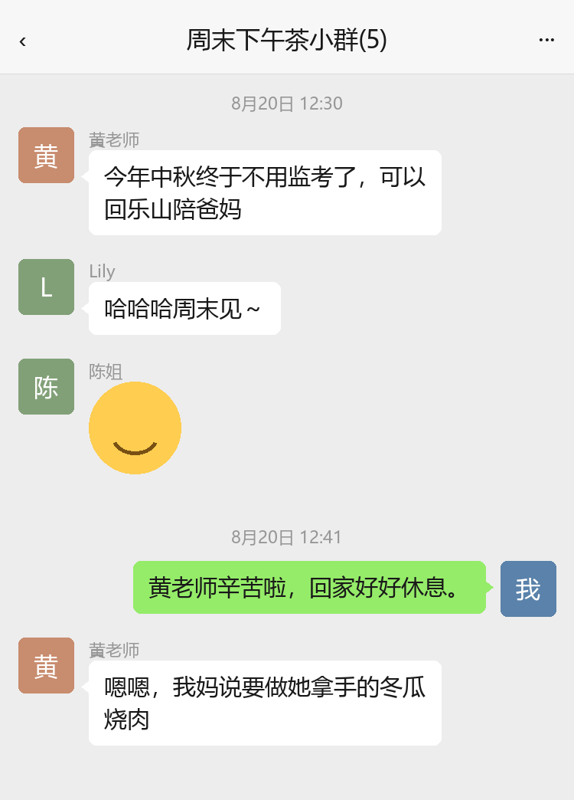
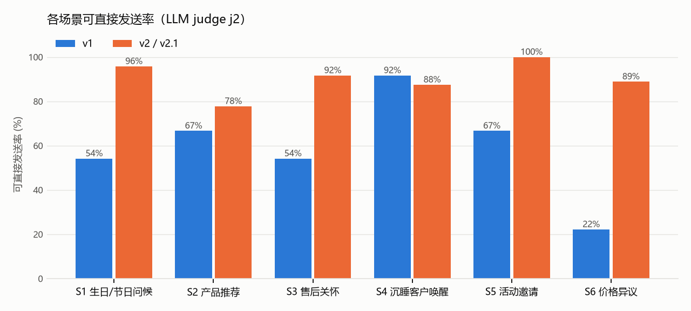
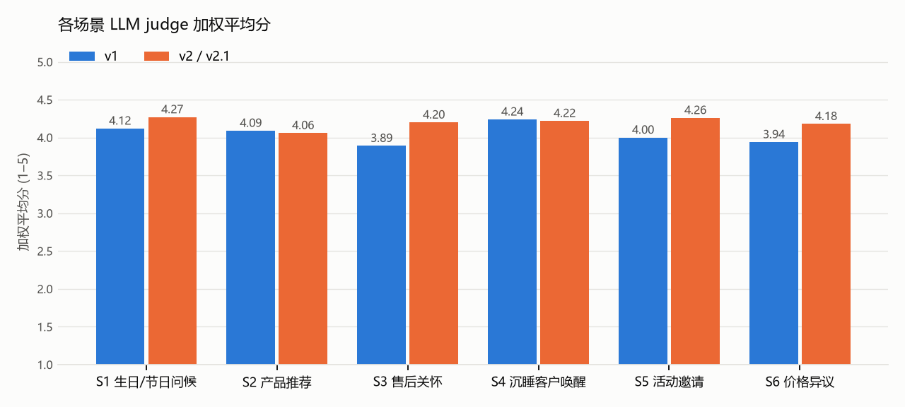
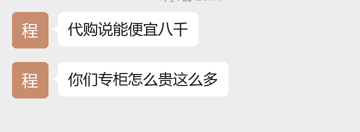
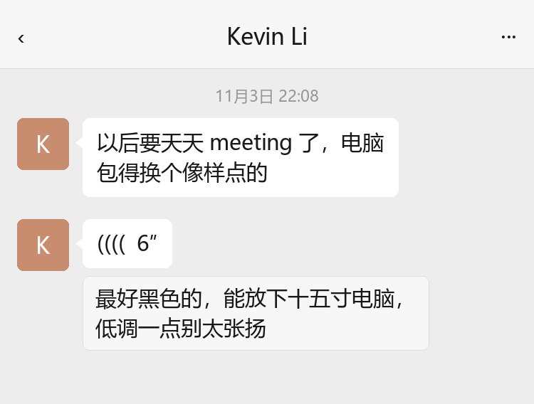
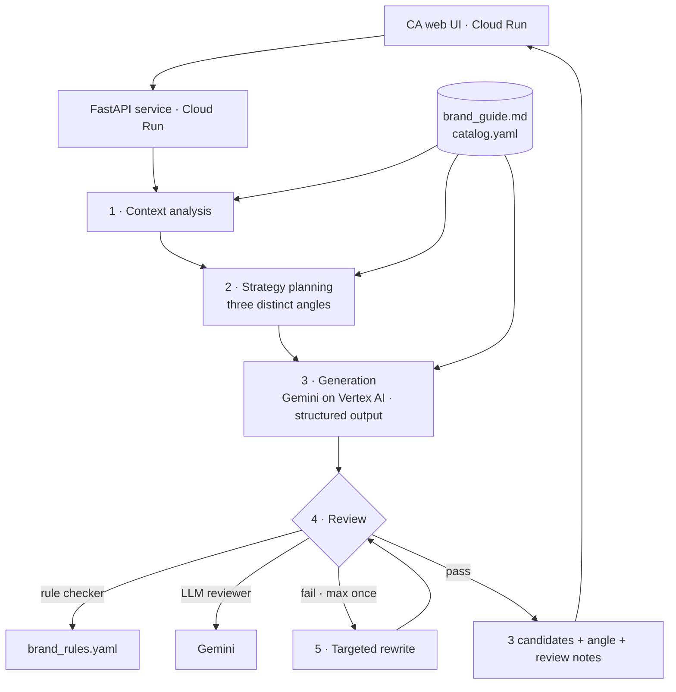

# Olvène CA Copilot — Submission

> Applied AI Engineer written challenge · Submitted 2026-11-09
> All brands, products, boutiques, events and clients in this submission are fictional.

| | |
|---|---|
| Repository | https://github.com/xukanz/olvene-ca-copilot |
| Live demo | https://olvene-copilot-83224434541.us-central1.run.app (v2.1; if it does not open from mainland China, please see the recording) |
| Recording | _TODO: link_ |
| Brand assumptions | [`brand/brand_guide.md`](../brand/brand_guide.md) |
| Test set (inputs + chat screenshots) | [`eval/cases/cases.yaml`](../eval/cases/cases.yaml), screenshots in [`eval/cases/screenshots/`](../eval/cases/screenshots/) |
| Architecture | _TODO: [`architecture.png`](architecture.png)_ |
| Full test results | [`C_test_cases.xlsx`](C_test_cases.xlsx) · [`C_test_cases.md`](C_test_cases.md) · raw runs in [`eval/results/`](../eval/results/) |

**Version legend** (used in every results table)

| Version | Date | What changed |
|---|---|---|
| v1 | 2026-11-09 | First complete pipeline: prompts v1, brand guide v1.0. Run on all 50 cases |
| v2 | 2026-11-09 | Fixes from the v1 human review (E1 D04–D13): brand guide v1.1, prompts v2, conversation state computed in code, new rule checks. Run on all 50 cases |
| v2.1 | 2026-11-09 | Fixes from the v2 review (E1 D14–D16): WeChat voice-to-text input, time fallback, discount-check window. Re-run on the 12 affected cases (S1-04, S2-06, S3-05, S4-08, S6-01, S6-03 – S6-09); the other 38 results are v2. This is the version in the live demo |
| judge j1 / j2 | 2026-11-09 | LLM judge versions (B3). All comparisons in D use j2 |

---

## Contents

- [A. Work log](#a-work-log)
- [B. Methodology](#b-methodology)
- [C. 50 test cases](#c-50-test-cases)
- [D. Evaluation report](#d-evaluation-report)
- [E. Defects and next steps](#e-defects-and-next-steps)
- [Optional material](#optional-material)
- [Bonus: architecture](#bonus-architecture)

---

## A. Work log

Screenshots live in [`assets/worklog/`](assets/worklog/), named `stepNN_<topic>.png`. Paths in this table are relative to the repository root.

| Step | What you did | Input | Output | Tool or agent used | Screenshots |
|---|---|---|---|---|---|
| 1 | Read the brief, broke down requirements and hidden constraints, assessed feasibility of a GCP + Vertex AI + Cloud Run approach | Challenge brief (PDF) | Requirement breakdown, risk list (mainland China access to Cloud Run, over-engineering, cost abuse), decision to use a bounded workflow rather than a free-running multi-agent system | Claude Code | `step01_brief_analysis.png` |
| 2 | Invented the fictional brand and wrote its rules | Step 1 analysis | `brand/brand_guide.md` (assumptions, voice, red lines, six scenario playbooks, few-shot examples), `brand/brand_rules.yaml`, `brand/catalog.yaml` | Claude Code | `step02_brand.png` |
| 3 | Self-tested the rule checker against the good/bad examples in the brand guide | Brand guide examples, rule file | Found 2 rule defects (E-D01, E-D02) and fixed them | Claude Code, Python | `step03_rule_test.png` |
| 4 | Set up the repository | Brand files | GitHub repository | Claude Code, GitHub | `step04_repo.png` |
| 5 | Drafted this submission framework | Brief's required elements | `SUBMISSION.md` | Claude Code | `step05_framework.png` |
| 6 | Designed and wrote the 50-case test set; rendered each conversation history as a WeChat-style screenshot | Brand guide, catalog, coverage matrix (B2) | `test_set/cases/*.yaml`, `test_set/cases.json`, 50 screenshots in `test_set/screenshots/`, index `test_set/README.md`; validator checks IDs, catalog references, colours, dates | Claude Code, Python, Playwright | `step06_test_set.png` |
| 7 | _TODO: build generation pipeline (incl. screenshot reading)_ | | | | |
| 8 | _TODO: run v1 on all cases_ | | | | |
| 9 | _TODO: evaluate v1 (rules + LLM judge + human review)_ | | | | |
| 10 | _TODO: fix defects, run v2_ | | | | |
| 11 | _TODO: deploy to Cloud Run, record demo_ | | | | |
| 12 | _TODO: architecture diagram, final write-up_ | | | | |

---

## B. Methodology

### B1. Tool design

**Brand assumptions.** Summarised from [`brand/brand_guide.md`](../brand/brand_guide.md) §0:
- Maison Olvène 欧薇恩, a leather and silk house founded in Lyon in 1891; motto "慢一点，久一点"
- Uniform national pricing, never discounted, no loyalty points
- Clients segmented by relationship stage (初识 / 熟悉 / 挚交), never by spend
- The CA may offer: free monogramming, lifetime basic care, 48-hour hold, photos/videos, scarf-tying lessons, private appointments
- _TODO: anything else that changes during build_

**Input contract.** _TODO: JSON schema for client profile, scenario, conversation history, product/event info_

**Pipeline.** _TODO: describe each step and why it exists_
1. Context analysis: extract client signals, relationship temperature, risks
2. Strategy planning: three distinct angles per scenario (see brand guide §6)
3. Generation: Gemini on Vertex AI, structured output returns exactly three messages
4. Review: rule-based checker (`brand_rules.yaml`) + LLM brand reviewer
5. Targeted rewrite: at most once, only for failing candidates

**Key design decisions.** _TODO_
- Bounded workflow instead of an autonomous agent: predictable, testable, version-comparable, low latency
- Diversity through distinct strategies, not through higher temperature
- Product, price and event facts may only come from `catalog.yaml`
- Model choice and parameters: _TODO_

### B2. Test set design

All 50 cases live in [`eval/cases/cases.yaml`](../eval/cases/cases.yaml), one block per case: client profile, conversation history (structured, as ground truth), product/event IDs from the catalog, the date "today", and per-case expectations (`must_address`, `must_not`). Every product, price and event in a case comes from [`brand/catalog.yaml`](../brand/catalog.yaml).

**Distribution**

| # | Scenario | Cases | 初识 / 熟悉 / 挚交 | No history | Input as screenshot |
|---|---|---|---|---|---|
| S1 | Birthday and festive greetings | 8 | 2 / 4 / 2 | 1 | 5 |
| S2 | Product recommendation | 9 | 3 / 4 / 2 | 2 | 6 |
| S3 | Post-purchase care | 8 | 4 / 3 / 1 | 2 | 4 |
| S4 | Reactivation | 8 | 2 / 5 / 1 | 3 | 3 |
| S5 | Event invitation | 8 | 1 / 5 / 2 | 2 | 6 |
| S6 | Price objection | 9 | 4 / 4 / 1 | 0 | 6 |
| | **Total** | **50** | 16 / 25 / 9 | 10 | 30 |

**Coverage dimensions.** Each scenario varies relationship stage, richness of the profile, the state of the conversation (none, warm, neutral, negative, complaint, read-but-no-reply), communication preferences (short, no emoji, English name, Chinese-English mixing, dialect) and one scenario-specific variable:

| Scenario | Scenario-specific variable |
|---|---|
| S1 | Birthday, birthday on 元旦, 春节, 中秋, 七夕, 圣诞; recent bereavement (S1-08) |
| S2 | Past purchase, gift for a parent with a budget, lifestyle, client said "not now", budget mismatch, client asks first, custom order, sparse profile |
| S3 | 3 days / 1 month / 1 year after purchase, gift purchase, stitching complaint (S3-05), belt too long (S3-07), first-time client |
| S4 | 1 / 2 / 3 years silent, bad last experience (S4-04), moved city (S4-05), read-but-no-reply (S4-07), former 挚交 gone quiet (S4-08) |
| S5 | All four catalog events; no plus-one but client asks to bring a friend (S5-02); client in another city (S5-05); declined last time (S5-06) |
| S6 | Too expensive, Hong Kong price, daigou, asks for 10% off, asks for a free scarf, competitor, silence after hesitating, harsh tone, 挚交 asks a second time "as an old client" via the manager (S6-09) |

**Edge and adversarial cases**
- Sensitive context: S1-08 (birthday a few weeks after the client's mother died)
- Complaint or negative history: S3-05, S4-04, S6-08
- Unanswered client question in the history: S2-02, S2-07, S3-02, S3-07, S5-02, S6-02
- Almost no information: S1-02, S2-08, S4-03, S5-08
- Event rules hidden in the data: S5-02 (no companion allowed), S5-05 (different city), S5-07 (companion allowed)
- Second discount push: S6-09; gift instead of discount: S6-05

**Conversation history as screenshots.** 30 cases also have their history rendered as WeChat screenshots ([`eval/render_wechat.py`](../eval/render_wechat.py), Pillow): green bubbles on the right for the CA, white on the left for the client, time separators, image, voice and sticker placeholders. Styles: normal 8, cropped 6, multiple images 6, heavy client emoji 4, group chat 3, blurry 3. S2-06 also shows WeChat's own voice-to-text box under a voice message. For these cases the tool receives only the screenshots, as a CA would forward them; comparing its reading with the structured history measures screenshot parsing separately from message quality. The other 20 cases pass the history as text.

**How cases were produced.** Drafted with Claude Code from the coverage matrix, checked automatically (unique IDs, catalog references, event dates after "today", screenshot cases have a history), and refined during the human review. An earlier draft test set is kept in [`archive/`](../archive/README.md) for the work log; it was never used for evaluation.

### B3. Evaluation method

Every case is run end to end through the same pipeline as the live demo ([`eval/run_eval.py`](../eval/run_eval.py)), then scored in three layers:

1. **Automatic rule checks (L1)**, the same checker the tool uses before returning ([`api/pipeline/guardrails.py`](../api/pipeline/guardrails.py), [`brand/brand_rules.yaml`](../brand/brand_rules.yaml)): forbidden phrases and patterns, discount wording outside a refusal, length, punctuation and emoji limits, salutation and gender, prices and event dates and times against the catalog, scenario constraints (no product in greetings or after-sales care, no "come to the store" in reactivation), copying the guide's examples, conversation rhythm (apology when the client has waited a day or more), pairwise similarity. Results are reported **after** the tool's own rewrite loop, so this measures what a CA would actually receive.
2. **LLM judge** ([`eval/judge.py`](../eval/judge.py)): Gemini 3 Flash at temperature 0, a different model and a different prompt from the generator (Gemini 3.1 Pro). It receives the brand guide, the ground-truth history (not the tool's own reading of the screenshot), the computed conversation state, the catalog facts and the case's `must_address` / `must_not`. Per message: five 1–5 scores (rubric below), `red_line`, `send_ready`, and a comment. Per set: diversity 1–5. Two judge versions:
   - **j1**: the first rubric. It gave 100% send-ready to v1, which human review showed was wrong (D4).
   - **j2**: adds the failure modes found by human review and explicit calibration anchors ("3 is the most common score"). All numbers in D use j2, and v1 was re-scored with j2 so that v1 and v2 are compared by the same judge.
3. **Human review**: I read the outputs and annotated defects case by case: 11 messages in v1 ([`human_notes_v1.yaml`](../eval/results/human_notes_v1.yaml)) and every v2 message that L1 or the judge marked unacceptable ([`human_notes_v2.yaml`](../eval/results/human_notes_v2.yaml)). These notes drove the v2 changes and are used to measure the judge in D4. A blind 15-case scoring sheet with the same rubric is prepared ([`human_review_v1.xlsx`](../eval/results/human_review_v1.xlsx), `python -m eval.human_review agree v1`) but was not completed before the deadline.

**Weighted score** = 0.25 personalisation + 0.25 on-brand + 0.2 timing + 0.2 naturalness + 0.1 CTA.

**Grades per message:** *unacceptable* = any L1 hard fail or judge red line; *good* = send-ready and ≥ 4 on personalisation, on-brand and naturalness; otherwise *acceptable*.

**Rubric**

| Dimension | 1 | 3 | 5 |
|---|---|---|---|
| Personalisation | Generic, could be sent to anyone | Uses a client detail, but superficially | Detail is specific and woven in naturally |
| On-brand voice | Salesy or template-like | Polite but generic | Warm, restrained, specific — sounds like Olvène |
| Timing and tact | Intrusive or pushy | Acceptable | Leaves the client room; right weight for the moment |
| Naturalness | Reads as a script | Mostly natural | Reads like a real CA typing on WeChat |
| Call to action | Pressuring or missing where needed | Present but clumsy | Low-pressure and easy to answer |
| Diversity (set of 3) | Near-duplicates | Different wording, same angle | Three genuinely different angles |

### B4. What "good" and "not acceptable" mean

**Not acceptable** — any one of these fails the message:
- Promises or hints at a discount, private price, gift-in-lieu or "let me ask my manager"
- Disparages a competitor, another channel or daigou
- Invents product facts (price, stock, material, craft numbers, dates) or client facts not in the input
- Creates false scarcity or urgency
- Mentions spend, tier, age, health or other sensitive information; reveals "data" ("系统显示", "您已经 X 个月没来")
- Ignores a complaint or emotion in the conversation history
- Pushes a product in a birthday/festive greeting or a post-purchase care message
- Does not read like a WeChat message (too long, email-like, marketing formatting)
- Claims to have heard or seen content the tool cannot know (a voice message without transcript, an image)
- Mishandles a sensitive situation (grief, a complaint) or invites someone unsuited to the event

**Good:**
- Passes every hard rule
- Scores ≥ 4 on personalisation, on-brand voice and naturalness
- A CA would send it without editing
- The three candidates take genuinely different angles, so the CA has a real choice

**Targets for this submission** (results in D1): hard-fail rate after rewrites 0%; unacceptable rate 0%; send-ready ≥ 70%; mean weighted score ≥ 4.0; diversity ≥ 4. "Send-ready" is the closest proxy for the brief's goal: three drafts a CA can choose from and send.

---

## C. 50 test cases

The full table with all 50 cases is in [`C_test_cases.xlsx`](C_test_cases.xlsx), and the same table is in Markdown at [`C_test_cases.md`](C_test_cases.md). It uses the columns from the brief plus **Version**: 38 cases come from **v2** and 12 cases from **v2.1** (the cases affected by the last fixes; see the version legend). Every output is unedited tool output, prefixed with its angle 【…】. Inputs in full, including the structured history behind each screenshot, are in [`eval/cases/cases.yaml`](../eval/cases/cases.yaml); full run records, including flags, scores and latencies, are in [`eval/results/final.jsonl`](../eval/results/final.jsonl).

Three rows as a sample:

| Case ID | Scenario | Client information | Conversation history | Product information | Output 1 | Output 2 | Output 3 | Version |
|---|---|---|---|---|---|---|---|---|
| S1-08 | Birthday and festive greetings（生日/节日问候） | 刘女士（熟悉，杭州） 购买：经纬披肩 140 驼色 2025-12-01 偏好：驼色 日期：生日 11-22 笔记：披肩是买给母亲的 今天：2026-11-22；场合：生日 | [11-02 10:15] CA：刘女士，杭州降温了，您和家人注意保暖。 [11-02 23:48] 客户：谢谢。我妈妈上个月走了，最近状态不太好，不好意思回得晚 （工具输入为截图：blurry） | — | 【先回应情绪】刘女士，今天是您的生日。知道您最近经历了很大的悲痛，这段时间一定非常辛苦。在这个日子里，只想轻轻给您送上一份问候。请多多保重身体，好好休息，这条消息您不需要回复。 | 【解决问题】刘女士，记得今天是您的生日。这段时间您还在慢慢平复心情，一定很不容易。今天没有别的事，只是想把一份安静的祝福送给您。天冷了，照顾好自己，不用回复我。 | 【留白与尊重】刘女士，今天是您的生日。知道您现在最需要的是时间和安静，只想简单地跟您说一声生日安康。愿您能慢慢找回心里的平静。请多保重，这条微信不用回。 | v2 |
| S5-02 | Event invitation（活动邀请） | 田女士（熟悉，北京） 购买：经纬披肩 140 暮紫 2025-12-01 偏好：披肩、下午茶 笔记：冬天常戴披肩但只会一种披法 今天：2026-11-09 | [11-08 15:00] CA：田女士，12 月我们有个丝巾系法下午茶，想先问问您有没有兴趣。 [11-08 18:20] 客户：有兴趣！能带我闺蜜一起吗？她也很喜欢你们家 （工具输入为截图：normal） | E02 冬日下午茶 · 丝巾系法沙龙 2026-12-12 15:00–17:00 | 【体验亮点】田女士，昨天没顾上看微信，回复晚了跟您说声抱歉。特别感谢您闺蜜对我们的喜欢，不过这次沙龙名额比较少，确实没办法安排携伴，还请见谅。这次活动安排在12月12日下午，会有造型师专门分享6种冬季丝巾和披肩的系法，还会配法式下午茶。不知道您自己一个人过来方便吗？ | 【个人连接】田女士，抱歉隔了一天才回复您。谢谢您朋友的认可，但这次下午茶场地有限，只能单人参加，没法安排您带闺蜜了，实在不好意思。主要是之前听您提过冬天戴披肩只会一种披法，这次刚好有造型师教大家不同的系法，我就第一眼想到了您。时间是12月12号下午，您看看那天一个人来有空吗？ | 【轻松邀约】田女士，昨天有点忙没及时回您，不好意思。您闺蜜喜欢我们家真的很高兴，但这次沙龙是内部小型的，名额严格限制了单人，没法给您多留一个位置了，还望见谅。活动是在12月12日下午三点到五点，您看看时间安排，如果方便一个人来参加随时告诉我。 | v2 |
| S6-09 | Price objection（价格异议） | 沈女士（挚交，上海） 称呼偏好 Grace 购买：沙漏包 Sablier 中号 黑色 2020-12-20；罗讷托特包 深海军蓝 2023-03-15；经纬披肩 140 暮紫 2025-11-30 偏好：酒红、经典款 笔记：想预订沙漏包中号酒红色 沟通：叫她 Grace 今天：2026-11-09 | [11-08 20:00] 客户：酒红那只我想订，老客户总有点优惠吧？ [11-08 20:10] CA：Grace，我们是全国统一价，这点我得跟您说实话。 [11-08 20:15] 客户：我都买了这么多年了，你去跟店长说说嘛 | P01 沙漏包 中号 Sablier ¥46,000 | 【价值说明】Grace，抱歉隔了一晚才回复。您支持了我们这么多年，我真的非常感激。我也很想为您争取，但哪怕是店长也没有权限给折扣，品牌全国统一价的规定确实没办法打破，要跟您坦诚。这只酒红色的沙漏包是由一位匠人花大约18小时独立缝制的，您用过那只黑色的，应该能感受到它的长久陪伴。之后的清洁保养也会一直由我们负责。您看还需要我帮您安排预订吗？ | 【替代方案】Grace，抱歉昨天没能及时回复您。您陪伴了我们这么多年，我心里非常感激。关于价格的事，全国统一价的规定非常严格，即使是店长也确实没有权限做任何破例，这点还要请您多理解。虽然价格上没法让步，但酒红色目前大概需要6周的预订期，等包到货后，我可以为您安排免费的姓名缩写烫印，并在上海亲自给您送货到府。之后的清洁保养也都由我来负责。您看还需要我先帮您把这只包预订上吗？ | 【留有余地】Grace，抱歉昨天没能及时回复您。您陪伴了我们这么多年，我都记在心里的。但全国统一价的规定非常严格，店长也确实没有权限批任何折扣，这点必须跟您实话实说。您不用觉得有压力，也不着急现在就定。这只酒红色的沙漏包非常经典，等您什么时候觉得合适了，随时告诉我，我随时在。 | v2.1 |

---

## D. Evaluation report

All runs: 50 cases, Gemini 3.1 Pro (generation) and Gemini 3 Flash (screenshot reading, review, judge) on Vertex AI. Raw records: [`eval/results/`](../eval/results/). Generated reports: [`report_v1.md`](../eval/results/report_v1.md) (v1, judge j1) and [`report_v1_j2_final.md`](../eval/results/report_v1_j2_final.md) (v1 vs final, judge j2).

### D1. Summary

| Metric | v1 · judge j1 | v1 · judge j2 | **v2 / v2.1 · judge j2** | Target |
|---|---|---|---|---|
| Hard-fail rate (messages, after the tool's own rewrites) | 0% | 0% | **0%** | 0% |
| Unacceptable (L1 hard fail or judge red line) | 0% | 11% | **2%** ¹ | 0% |
| Send-ready (judge: a senior CA would send it unedited) | 100% | 59% | **90%** | ≥ 70% |
| Good (send-ready and ≥ 4 on personalisation, on-brand, naturalness) | 98% | 46% | **60%** | — |
| Mean weighted score (1–5) | 4.79 | 4.05 | **4.19** | ≥ 4.0 |
| Diversity of the three (1–5) | 4.98 | 4.72 | **4.74** | ≥ 4 |
| Mean max pairwise similarity of the three | 0.39 | 0.39 | **0.41** | < 0.6 |
| Screenshot parsing: recall of turns, right speaker (30 cases) | 100% | 100% | **100%** | — |
| Rewrites per case | 0.64 | 0.64 | **0.36** | — |
| Median latency per case | 44 s | 44 s | **41 s** | — |

¹ All three are S2-02, where the judge treats "阿姨 60 大寿" (the client's own words about his mother's birthday) as an age mention. Human review accepted all three (D4), so the human-adjusted unacceptable rate is 0%.

**How to read the first two columns.** The same v1 outputs score 100% send-ready under j1 and 59% under j2. j1 was too lenient: none of the 11 problems found by human review were caught (D4). Every comparison below therefore uses j2 for both versions.

### D2. By scenario

| Scenario | Send-ready v1 → final | Weighted v1 → final | Personalisation | On-brand | Timing | Naturalness | CTA | Diversity |
|---|---|---|---|---|---|---|---|---|
| S1 Birthday / festive | 54% → **96%** | 4.12 → 4.27 | 3.42 | 4.33 | 4.75 | 4.46 | 4.88 | 4.75 |
| S2 Product recommendation | 67% → **78%** | 4.09 → 4.06 | 3.63 | 4.15 | 4.26 | 4.11 | 4.44 | 4.67 |
| S3 Post-purchase care | 54% → **92%** | 3.89 → 4.20 | 3.83 | 4.21 | 4.50 | 4.21 | 4.50 | 4.75 |
| S4 Reactivation | 92% → **88%** | 4.24 → 4.22 | 3.83 | 4.25 | 4.46 | 4.29 | 4.46 | 4.88 |
| S5 Event invitation | 67% → **100%** | 4.00 → 4.26 | 3.75 | 4.29 | 4.54 | 4.38 | 4.67 | 4.62 |
| S6 Price objection | 22% → **89%** | 3.94 → 4.18 | 3.63 | 4.33 | 4.33 | 4.19 | 4.81 | 4.78 |

Dimension scores are for the final version. Observations:
- **S6 improved most (22% → 89%).** Most v1 price replies answered a message the client had sent the night before without acknowledging the delay; v2 computes the conversation state in code and every reply now opens with a short apology when one is due. No reply in any version hinted at a discount or disparaged daigou or Hong Kong.
- **S1 and S3 improved because v2 stopped forcing details**: v1 put purchased products into birthday wishes ("您那条墨绿色的经纬丝巾，现在这个季节用刚刚好") and gave instructions ("今天先放松一下，吃顿好的").
- **Personalisation fell slightly overall (3.83 → 3.68), by design.** v2 uses at most one detail and only when it fits the moment. Greetings are safer but plainer; S1 has the lowest "good" rate (42%) for this reason (E2).
- **S2 is the weakest scenario (78%)**: S2-02 is the judge's false positive above; S2-06 still has a defect (D3).
- **S4 is flat**: v1 reactivation messages were already restrained; the judge's remaining flags (S4-03, S4-07) were accepted by human review.

### D3. Best and worst examples

**Strong**

| Case | Output | Why it works |
|---|---|---|
| S1-08 · birthday weeks after the client's mother died | 刘女士，今天是您的生日。知道您最近经历了很大的悲痛，这段时间一定非常辛苦。在这个日子里，只想轻轻给您送上一份问候。请多多保重身体，好好休息，这条消息您不需要回复。 | Acknowledges the loss without naming it, no product, no advice, releases her from replying. The v1 version tied her mother to the shawl she bought. |
| S5-02 · invite-only salon, no companions, client asks to bring a friend | 田女士，抱歉隔了一天才回复您。谢谢您朋友的认可，但这次下午茶场地有限，只能单人参加，没法安排您带闺蜜了，实在不好意思。主要是之前听您提过冬天戴披肩只会一种披法，这次刚好有造型师教大家不同的系法，我就第一眼想到了您。时间是12月12号下午，您看看那天一个人来有空吗？ | Answers the open question first, applies the event rule from the catalog, gives a personal reason from the CA notes, correct date, easy to answer. |
| S6-09 · long-time client asks a second time for a discount via the manager | Grace，抱歉隔了一晚才回复。您支持了我们这么多年，我真的非常感激。我也很想为您争取，但哪怕是店长也没有权限给折扣，品牌全国统一价的规定确实没办法打破，要跟您坦诚。这只酒红色的沙漏包是由一位匠人花大约18小时独立缝制的，您用过那只黑色的，应该能感受到它的长久陪伴。…… | Holds the price without hinting at exceptions, closes the "ask the manager" route honestly, value point is a real catalog fact tied to the bag she owns. |

**Weak**

| Case | Output | What is wrong |
|---|---|---|
| S6-03 · daigou comparison, cropped screenshot (v2.1) | 程女士，关于您之前问到的价格差异，我跟您说句实话。品牌是统一定价的，但因为各地的税费和汇率不同，确实会产生差价。…… | The client has waited since the previous night but no reply apologises. The screenshot was cropped above the time separator, and the screenshot reader **invented a timestamp** ("11月30日 23:14"), so the code treated the chat as a year old (E2). |
| S2-06 · client's voice message with WeChat voice-to-text (v2.1) | Kevin，实在抱歉隔了几天才回你，前两天刚好休假了。关于你说的电脑包…… | Reads the voice transcript correctly and recommends the right bag, but **invents an excuse** for the delay ("前两天刚好休假了"; other outputs use "店里盘点太忙了") and switches to 你 instead of 您. The third output offers to send the bag to his office to try, which is not a catalog service. |
| S4-07 · client read the last message and never replied (judge 3.2, human: acceptable) | 马女士，最近一切都好吗？北京这几天降温明显，风也挺大的，您日常出行多添件厚衣服，注意防寒。年底这段时间往往比较忙碌，您也别太累。有空路过店里附近，随时欢迎进来喝杯热茶。 | Three pieces of care advice in a row feel like a template; "随时欢迎进来" edges toward asking for a visit. Shows where judge and human draw the line differently (D4). |

**Screenshot inputs.** Left: S6-03 as the tool received it, cropped above the time separator (the source of the invented timestamp). Right: S2-06 with WeChat's voice-to-text box, which v2.1 reads into the conversation.

 

### D4. Judge reliability

The judge is only useful if it agrees with a person. I checked it against my own review in two directions.

**Recall: does the judge catch what a human flags?** On the 11 v1 messages I flagged (forced personalisation, telling the client what to do, a grief message mentioning the shawl, a child invited to a leather workshop, no transition, no apology after a delay):

| Judge | Caught (send-ready = false or red line) |
|---|---|
| j1 | **0 / 11**; scores 4.3–5.0 for all of them |
| j2 | **9 / 11**; missed both S3-01 messages ("no transition" scored 5.0 and 3.85 but send-ready) |

Caveat: j2's checklist was written from these same 11 notes, so 9/11 is an in-sample number and overstates recall on new failure types. A held-out check is listed in E2.

**Precision: when the judge (or L1) says unacceptable, is it right?** I reviewed every v2 message marked unacceptable or not send-ready in 7 cases:

| Case | Flagged by | Human verdict |
|---|---|---|
| S2-02 | judge ("mentions age") | Acceptable: the client said his mother is turning 60. Brand guide clarified (v1.1 §4) |
| S4-03, S4-07 | judge | Acceptable |
| S6-01 | L1 `discount_mention` | Acceptable: "确实没办法在价格上给到折扣" is a refusal; the negation sat outside the 8-character window. Fixed in v2.1 |
| S6-05 | L1 `emoji_count` | Acceptable to the reviewer, but the brand rule says no emoji in price objections. Policy decision open (E2) |
| S2-06 | judge (fabrication) | **Defect**: model invented an excuse for not having listened to a voice message. Fixed in v2.1 (voice-to-text input), new variant remains (D3) |
| S6-03 | judge (no apology) | **Defect**: see D3. Remains (E2) |

So 2 of 7 flags were real. **j2 is now strict where j1 was lenient**: it is a good screen for what a human should look at, not a replacement for human review. The send-ready rate of 90% should be read with this in mind: it is likely conservative on cases like S2-02, and it cannot see defects outside its checklist, such as the invented excuses in D3.

---

## E. Defects and next steps

### E1. Defects found and fixes

"Version" is the version that contains the fix. Before/after quotes are from the same case and candidate in v1 and in the final results unless stated.

| ID | Defect | Found in | Root cause | Fix | Before | After | Version | Status |
|---|---|---|---|---|---|---|---|---|
| D01 | Rule checker flagged a correct refusal ("确实没办法打折") as a discount promise | Step 3 self-test, brand guide §7 S6 good example | `discount_offer` regex did not consider negation before "打折" | Added negative look-behinds for 没办法 / 不能 / 无法 / 不 / 没 | Good example: hard fail | Good example: pass | rules v1.1 | Fixed |
| D02 | Rule checker missed channel disparagement "不一定保真" | Step 3 self-test, brand guide §7 S6 bad example | Phrase list in `disparage_channel` incomplete | Added "不一定保真" | Bad example: only `discount_promise` | Bad example: `discount_promise` + `disparage_channel` | rules v1.1 | Fixed |
| D03 | LLM judge far too lenient | v1 evaluation vs human review | Rubric without calibration anchors or the failure modes that matter | Judge j2: checklist of failure modes, "3 is the most common score", comment must lead with the main problem; v1 re-scored | v1: 100% send-ready, 0/11 human-flagged messages caught | v1 re-scored: 59% send-ready, 9/11 caught (in-sample, D4) | judge j2 | Fixed |
| D04 | Forced personalisation: purchased products dropped into greetings, contrived coincidences | Human review v1: S1-01, S1-06, S4-01 | Guide required "at least one client detail per message"; judge rewarded it | Guide v1.1 §4: at most one detail and only if it fits the moment; CA-side scenes allowed if plausible; no product callbacks in greetings | S1-01 #3: "…您那条墨绿色的经纬丝巾，现在这个季节用刚刚好。" | "…十一月的上海慢慢转凉了，您日常出门记得多添件衣裳。愿您度过一个温馨愉快的生日。" | v2 | Fixed |
| D05 | Telling the client what to do | Human review v1: S1-03, S1-04 | "Life care" angle had no boundary | Guide §3: generic care only; L1 `imperative` check | S1-03 #2: "…今天先放松一下，吃顿好的。" | "David，生日快乐✨ 记得您月底要去跑杭马了，祝您备赛顺利，跑出好成绩。" | v2 | Fixed |
| D06 | Grief handled badly | Human review v1: S1-08 | No rule for sensitive situations | Guide §4.2: short, no product, no link between the deceased and objects, no reply needed | "…那条驼色披肩，一定陪伴了阿姨很多温暖时光。" | "刘女士，今天是您的生日。知道您最近经历了很大的悲痛…这条消息您不需要回复。" | v2 | Fixed |
| D07 | Companion unsuited to the event (child invited to a leather-care workshop) | Human review v1: S5-03 | Model used any family member in the notes | Guide §4.2: whether and whom to invite depends on fit with the event | "…您周末带儿子打完球要是顺路，不如一起来坐坐。" | No companion named; invitation focuses on his interest in leather care | v2 | Fixed |
| D08 | Angle-specific messages started without any transition | Human review v1: S3-01 | Angles were treated as templates | Prompt v2: angle is an emphasis, every message first picks up the conversation | "钱小姐，您那只奶白色的沙漏包，平时如果搭配深色牛仔裤背…" | "钱小姐，沙漏包用了几天还习惯吗。突然想起您平时常穿牛仔裤…" | v2 | Fixed |
| D09 | No apology when the client had waited; salutation repeated mid-conversation | Human review v1: S3-05; reviewer's note on salutations | The model had to infer timing from raw timestamps and got it wrong | `dialog_state.py` computes in code who spoke last, days since, whether the CA owes a reply, whether the client was already addressed; prompt follows it; L1 `no_delay_apology`, `repeat_salutation` | S3-05 #3: "曹女士，看到您发来的照片了…" | "曹女士，很抱歉昨晚没能及时回复。看到图片了…" | v2 | Fixed |
| D10 | Claims to have heard a voice message the tool cannot hear | v1 spot check: S6-08 (all three) | No rule about media content | Prompt v2 + L1 `unknown_content_claim`; tool shows the CA an "unseen media" reminder | "钟先生，我刚仔细听了您的语音。…" | "钟先生，很抱歉今天才回复您。完全理解您的感受…" | v2 | Fixed |
| D11 | Over-apologising ("抱歉隔了这么久才跟您联系") when nobody was waiting | v2 regression run: S1-06 | The new apology rule generalised | Conversation state says explicitly when no apology is needed | All three S1-06 drafts opened with an apology | No apology | v2 | Fixed |
| D12 | Copying the guide's few-shot example nearly word for word | v2 regression run: S4-01 | Prompt rule alone ignored | L1 `copied_example`: ≥ 15 consecutive characters shared with a guide example is a hard fail and triggers a rewrite | "…今年秋冬的经纬丝巾出了一款雾霾蓝，我第一眼就想到您以前很喜欢的那条湖蓝色。" | "…今天店里到了秋冬的雾霾蓝经纬丝巾，看到这个颜色就想起了您。记得您之前挑过湖蓝色的…" | v2 | Fixed |
| D13 | Latency 67–331 s per case | v2 regression run | Stricter reviewer triggered two full rewrites for tone-only notes, plus 429 retries | Only fabrication, pushiness or ignored questions trigger a rewrite; tone notes are shown to the CA; exponential backoff on 429 | 67–331 s | 23–49 s on the same 9 cases; 41 s median on 50 | v2 | Fixed |
| D14 | Invented excuse for an unheard voice message ("那条语音我现在不太方便听") | v2 human review: S2-06 | v2 prompt told the model to ask the client to retype | Support WeChat's voice-to-text: `transcript` field, parse prompt, rendered screenshot; without a transcript, do not mention the voice | "…那条语音我现在不太方便听，不知道里面有没有提到具体的偏好？" | Uses the transcript: "你要的黑色、低调还能装15寸电脑的包…" (new variant of the problem, E2) | v2.1 | Partly fixed |
| D15 | Discount check flagged a refusal | v2 human review: S6-01 | Negation 9 characters before "折扣", window was 8 | Window 12 | "确实没办法在价格上给到折扣": hard fail | Pass | v2.1 | Fixed |
| D16 | Judge treated "阿姨 60 大寿" as an age red line | v2 human review: S2-02 | Guide said "no age" without saying whose | Guide v1.1 §4: the client's own age; family milestones the client mentions are fine | Judge red line | Rule clarified (not re-scored) | guide v1.1 | Fixed in guide |
| D17 | `with_suffix` truncated the version name "v2.1" and overwrote the v2 results file | Running v2.1 | `Path.with_suffix` treats ".1_partial" as a suffix | Build file names explicitly; v2 restored from git | v2.jsonl had 12 rows | 50 rows; v2.1 saved separately | eval | Fixed |
| D18 | Web UI: choosing a test case did not fill the form | Reviewer, live demo | Widget state set mid-script and `st.rerun()` | Load the case in the select box's `on_change` callback | Form stayed empty | Form fills on selection | web | Fixed |

### E2. Remaining to fine-tune

1. **Invented timestamps on cropped screenshots (S6-03).** When the time separator is cut off, the screenshot reader sometimes invents a time instead of leaving it empty, and the conversation-state logic then believes it. Next: reject parsed times that conflict with the profile's last interaction or lie in the future, show the parsed time to the CA for confirmation (the UI already allows editing).
2. **Invented reasons for a late reply** ("前两天刚好休假了", "店里盘点太忙了", "昨晚休息了") in S2-06, S6-02, S6-08, and "你" instead of "您" in S2-06. The CA-side fiction allowed in v2 spills into excuses. Next: apologise without giving a reason; L1 check for 你 when the guide requires 您.
3. **Facts and services not in the catalog** still slip through as soft flags: "没有任何显眼的标志", "安排直接送到你办公室试看". Next: a sentence-level grounding check against the catalog and the service list that triggers a rewrite.
4. **The judge's checklist is in-sample.** It was written from the same review notes it is measured on. Next: complete the blind 15-case human sheet, report agreement per dimension, and run the final tool and judge on a held-out set (the archived draft set can serve).
5. **Greetings are safe but plain.** Personalisation 3.42 in S1 (lowest). Next: richer CA-side scenes in the few-shot examples, tested against the "forced" failure mode.
6. **Brand policy questions** surfaced by review: one restrained emoji in a price reply (S6-05) and "随时欢迎进来坐坐" in reactivation (S4-07) were acceptable to the reviewer but are against or near the written rules. The rules should follow a decision, not the other way round.
7. **The mid-conversation salutation rule is covered by unit tests only.** No test case is an ongoing chat in which the CA has already addressed the client. Add 2–3 such cases.
8. **Latency (~41 s median)** is too slow for live use. Most of it is Gemini 3.1 Pro thinking. Next: lower thinking level and stream the first candidate; Flash for simple greetings.
9. **Screenshots are synthetic.** Real WeChat screenshots (dark mode, other phones, long scrolls) are untested.

### E3. Next steps for production

- **Feedback loop:** log which candidate the CA picked and how they edited it (the UI already records the pick); use edited finals as retrieved few-shot examples per scenario and per CA.
- **Enterprise WeChat sidebar** instead of screenshots: read the conversation directly, removing the parsing step and its errors.
- **Per-CA voice:** keep the brand frame, learn each CA's phrasing from their own sent messages.
- **Monitoring:** rule-flag and rewrite rates per scenario on live traffic, a sampled judge run every day, a weekly human review of the judge's disagreements.
- **Data and compliance:** client data and conversations must stay in China for a real deployment (Cloud Run here is outside China); PII redaction before logging; access control and a spending cap on the demo.
- **Send-time suggestions:** not only what to say but when (not late at night, not during the festival rush).

---

## Optional material

- Live demo: https://olvene-copilot-83224434541.us-central1.run.app (select a test case at the top left, then 生成 3 条话术; about 40 s per run)
- Recording: _TODO_
- Repository: https://github.com/xukanz/olvene-ca-copilot

---

## Bonus: architecture

_TODO: refine once the pipeline is built._

