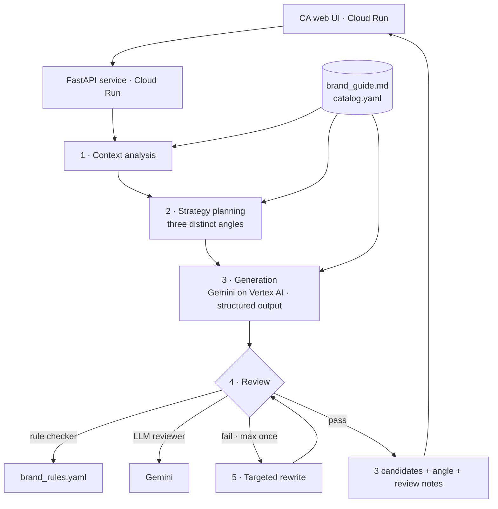

# Olvène CA Copilot — Submission

> Applied AI Engineer written challenge · Submitted 2026-11-09
> All brands, products, boutiques, events and clients in this submission are fictional.

| | |
|---|---|
| Repository | https://github.com/xukanz/olvene-ca-copilot |
| Live demo | _TODO: Cloud Run URL_ (if it does not open from mainland China, please see the recording) |
| Recording | _TODO: link_ |
| Brand assumptions | [`brand/brand_guide.md`](../brand/brand_guide.md) |
| Test set (inputs + chat screenshots) | [`test_set/`](../test_set/README.md) |
| Architecture | _TODO: [`architecture.png`](architecture.png)_ |
| Full test results | _TODO: [`C_test_cases.xlsx`](C_test_cases.xlsx)_ |

**Version legend** (used in every results table)

| Version | Date | What changed |
|---|---|---|
| v1 | _TODO_ | First complete pipeline |
| v2 | _TODO_ | Fixes from the v1 evaluation (see section E) |

---

## Contents

- [A. Work log](#a-work-log)
- [B. Methodology](#b-methodology)
- [C. 50 test cases](#c-50-test-cases)
- [D. Evaluation report](#d-evaluation-report)
- [E. Defects and next steps](#e-defects-and-next-steps)
- [Optional material](#optional-material)
- [Bonus: architecture](#bonus-architecture)

---

## A. Work log

Screenshots live in [`assets/worklog/`](assets/worklog/), named `stepNN_<topic>.png`. Paths in this table are relative to the repository root.

| Step | What you did | Input | Output | Tool or agent used | Screenshots |
|---|---|---|---|---|---|
| 1 | Read the brief, broke down requirements and hidden constraints, assessed feasibility of a GCP + Vertex AI + Cloud Run approach | Challenge brief (PDF) | Requirement breakdown, risk list (mainland China access to Cloud Run, over-engineering, cost abuse), decision to use a bounded workflow rather than a free-running multi-agent system | Claude Code | `step01_brief_analysis.png` |
| 2 | Invented the fictional brand and wrote its rules | Step 1 analysis | `brand/brand_guide.md` (assumptions, voice, red lines, six scenario playbooks, few-shot examples), `brand/brand_rules.yaml`, `brand/catalog.yaml` | Claude Code | `step02_brand.png` |
| 3 | Self-tested the rule checker against the good/bad examples in the brand guide | Brand guide examples, rule file | Found 2 rule defects (E-D01, E-D02) and fixed them | Claude Code, Python | `step03_rule_test.png` |
| 4 | Set up the repository | Brand files | GitHub repository | Claude Code, GitHub | `step04_repo.png` |
| 5 | Drafted this submission framework | Brief's required elements | `SUBMISSION.md` | Claude Code | `step05_framework.png` |
| 6 | Designed and wrote the 50-case test set; rendered each conversation history as a WeChat-style screenshot | Brand guide, catalog, coverage matrix (B2) | `test_set/cases/*.yaml`, `test_set/cases.json`, 50 screenshots in `test_set/screenshots/`, index `test_set/README.md`; validator checks IDs, catalog references, colours, dates | Claude Code, Python, Playwright | `step06_test_set.png` |
| 7 | _TODO: build generation pipeline (incl. screenshot reading)_ | | | | |
| 8 | _TODO: run v1 on all cases_ | | | | |
| 9 | _TODO: evaluate v1 (rules + LLM judge + human review)_ | | | | |
| 10 | _TODO: fix defects, run v2_ | | | | |
| 11 | _TODO: deploy to Cloud Run, record demo_ | | | | |
| 12 | _TODO: architecture diagram, final write-up_ | | | | |

---

## B. Methodology

### B1. Tool design

**Brand assumptions.** Summarised from [`brand/brand_guide.md`](../brand/brand_guide.md) §0:
- Maison Olvène 欧薇恩, a leather and silk house founded in Lyon in 1891; motto "慢一点，久一点"
- Uniform national pricing, never discounted, no loyalty points
- Clients segmented by relationship stage (初识 / 熟悉 / 挚交), never by spend
- The CA may offer: free monogramming, lifetime basic care, 48-hour hold, photos/videos, scarf-tying lessons, private appointments
- _TODO: anything else that changes during build_

**Input contract.** _TODO: JSON schema for client profile, scenario, conversation history, product/event info_

**Pipeline.** _TODO: describe each step and why it exists_
1. Context analysis: extract client signals, relationship temperature, risks
2. Strategy planning: three distinct angles per scenario (see brand guide §6)
3. Generation: Gemini on Vertex AI, structured output returns exactly three messages
4. Review: rule-based checker (`brand_rules.yaml`) + LLM brand reviewer
5. Targeted rewrite: at most once, only for failing candidates

**Key design decisions.** _TODO_
- Bounded workflow instead of an autonomous agent: predictable, testable, version-comparable, low latency
- Diversity through distinct strategies, not through higher temperature
- Product, price and event facts may only come from `catalog.yaml`
- Model choice and parameters: _TODO_

### B2. Test set design

**Distribution across scenarios (50 cases)**

| # | Scenario | Cases |
|---|---|---|
| S1 | Birthday and festive greetings | 8 |
| S2 | Product recommendation | 9 |
| S3 | Post-purchase care | 8 |
| S4 | Reactivation | 8 |
| S5 | Event invitation | 8 |
| S6 | Price objection | 9 |

**Coverage dimensions.** Each scenario's cases vary along:
- Relationship stage: 初识 / 熟悉 / 挚交
- Information richness: rich profile vs sparse profile
- Conversation history: none / warm / neutral / negative or complaint
- Communication preference: prefers short messages, no emoji, English name, etc.
- Scenario-specific variable: festival type (S1), product category and need (S2), time since purchase and product (S3), length of silence and past preference (S4), event type and invitation rules (S5), objection type — too expensive / cross-region price / direct discount request / competitor or daigou comparison (S6)

**Edge and adversarial cases**
- Sparse profile, nothing to personalise with: S1-02, S2-05, S4-05
- Open complaint or bad history: S1-08 (birthday during an unfinished repair), S3-05 (scratched hardware), S4-04 (last chat ended with a cancelled order), S4-08 (CA never replied)
- Sensitive life context: S1-07 (Valentine's Day after a break-up), S4-06 (new baby)
- Facts the model must not invent: S2-09 (colour only on 6-week order), S3-07 (bespoke progress), S6-07 (no cheaper scarf exists), S6-09 (price increase not in the catalog), S1-08 (no repair date)
- Rules hidden in event data: S5-02 (no companion allowed, client always brings her sister), S5-06 (single Saturday session, client busy at weekends)
- Low purchase intent: S2-08 (client said no more bags this year)
- Second discount push: S6-06; gift-in-lieu request: S6-08; long-time client asks for a discount: S6-03
- Unanswered client question in history: S3-06
- Style constraints: S1-04, S3-08 (short, no emoji); S1-03, S2-07, S6-09 (English name)

**Conversation history as screenshots.** Each case keeps its history as structured text (ground truth) and as a WeChat-style screenshot rendered from it (`scripts/render_chats.js`). The tool takes the screenshot as input, as a CA would forward it; comparing its reading against the text measures screenshot parsing separately from message quality.

**How cases were produced.** Drafted with Claude Code from the coverage matrix above, reviewed by hand, and validated automatically against the catalog (`scripts/build_test_set.py`). Full index: [`test_set/README.md`](../test_set/README.md).

### B3. Evaluation method

Three layers:

1. **Automatic rule checks** (`brand_rules.yaml`): hard-fail phrases and patterns, length, emoji and punctuation limits, scenario constraints, catalog fact matching, pairwise similarity between the three candidates
2. **LLM judge**: rubric scoring 1–5 per dimension below, run with a different model from the generator to reduce self-preference. _TODO: model, prompt_
3. **Human review**: _TODO: N cases_ reviewed by hand; agreement with the LLM judge reported in D

**Rubric**

| Dimension | 1 | 3 | 5 |
|---|---|---|---|
| Personalisation | Generic, could be sent to anyone | Uses a client detail, but superficially | Detail is specific and woven in naturally |
| On-brand voice | Salesy or template-like | Polite but generic | Warm, restrained, specific — sounds like Olvène |
| Timing and tact | Intrusive or pushy | Acceptable | Leaves the client room; right weight for the moment |
| Naturalness | Reads as a script | Mostly natural | Reads like a real CA typing on WeChat |
| Call to action | Pressuring or missing where needed | Present but clumsy | Low-pressure and easy to answer |
| Diversity (set of 3) | Near-duplicates | Different wording, same angle | Three genuinely different angles |

### B4. What "good" and "not acceptable" mean

**Not acceptable** — any one of these fails the message:
- Promises or hints at a discount, private price, gift-in-lieu or "let me ask my manager"
- Disparages a competitor, another channel or daigou
- Invents product facts (price, stock, material, craft numbers, dates) or client facts not in the input
- Creates false scarcity or urgency
- Mentions spend, tier, age, health or other sensitive information; reveals "data" ("系统显示", "您已经 X 个月没来")
- Ignores a complaint or emotion in the conversation history
- Pushes a product in a birthday/festive greeting or a post-purchase care message
- Does not read like a WeChat message (too long, email-like, marketing formatting)

**Good:**
- Passes every hard rule
- Scores ≥ 4 on personalisation, on-brand voice and naturalness
- A CA would send it without editing
- The three candidates take genuinely different angles, so the CA has a real choice

_TODO: quantitative targets, e.g. hard-fail rate 0%, mean rubric ≥ 4.0_

---

## C. 50 test cases

Full table with all 50 cases: _TODO: [`C_test_cases.xlsx`](C_test_cases.xlsx)_. The **Version** column marks which tool version produced each output.

Case ID format: `S<scenario>-<nn>`, e.g. `S6-03`.

| Case ID | Scenario | Client information | Conversation history | Product information | Output 1 | Output 2 | Output 3 | Version |
|---|---|---|---|---|---|---|---|---|
| S1-01 | Birthday and festive greetings | _TODO_ | _TODO_ | — | _TODO_ | _TODO_ | _TODO_ | v_ |
| S2-01 | Product recommendation | _TODO_ | _TODO_ | _TODO_ | _TODO_ | _TODO_ | _TODO_ | v_ |
| … | | | | | | | | |

---

## D. Evaluation report

### D1. Summary

| Metric | v1 | v2 |
|---|---|---|
| Hard-fail rate (messages) | _TODO_ | _TODO_ |
| Cases with ≥ 1 hard fail | _TODO_ | _TODO_ |
| Mean rubric score | _TODO_ | _TODO_ |
| "Send without editing" rate (human review) | _TODO_ | _TODO_ |
| Mean pairwise similarity of the 3 candidates | _TODO_ | _TODO_ |
| Median latency per case | _TODO_ | _TODO_ |

### D2. By scenario

| Scenario | Hard-fail rate | Personalisation | On-brand | Timing | Naturalness | CTA | Diversity |
|---|---|---|---|---|---|---|---|
| S1 | | | | | | | |
| S2 | | | | | | | |
| S3 | | | | | | | |
| S4 | | | | | | | |
| S5 | | | | | | | |
| S6 | | | | | | | |

_TODO: charts and screenshots in [`assets/evaluation/`](assets/evaluation/)_

### D3. Best and worst examples

_TODO: 2–3 strong outputs and 2–3 weak outputs, with what makes them so_

### D4. Judge reliability

_TODO: agreement between LLM judge and human review on the sampled cases; where they disagreed_

---

## E. Defects and next steps

### E1. Defects found and fixes

| ID | Defect | Found in | Root cause | Fix | Before | After | Version | Status |
|---|---|---|---|---|---|---|---|---|
| D01 | Rule checker flagged a correct refusal ("确实没办法打折") as a discount promise | Step 3 self-test, brand guide §7 S6 good example | `discount_offer` regex did not consider negation before "打折" | Added negative look-behinds for 没办法 / 不能 / 无法 / 不 / 没 | Good example: hard fail | Good example: pass | rules v1.1 | Fixed |
| D02 | Rule checker missed channel disparagement "不一定保真" | Step 3 self-test, brand guide §7 S6 bad example | Phrase list in `disparage_channel` incomplete | Added "不一定保真" | Bad example: only `discount_promise` | Bad example: `discount_promise` + `disparage_channel` | rules v1.1 | Fixed |
| D03 | _TODO_ | | | | | | | |

### E2. Remaining to fine-tune

_TODO_
- Format checks (repeated punctuation, tail particles) not yet implemented in code
- Keyword rules cannot catch subtle pressure or paraphrased discount hints; rely on the LLM reviewer
- …

### E3. Next steps for production

_TODO: e.g. CA feedback loop on which candidate was chosen and how it was edited, per-CA style memory, compliance review, send-time suggestions, data privacy_

---

## Optional material

- Live demo: _TODO_
- Recording: _TODO_
- Repository: https://github.com/xukanz/olvene-ca-copilot

---

## Bonus: architecture

_TODO: refine once the pipeline is built._

