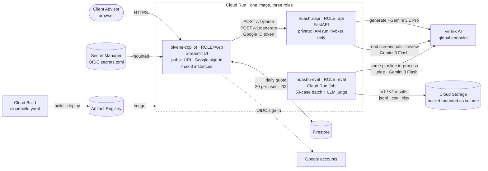
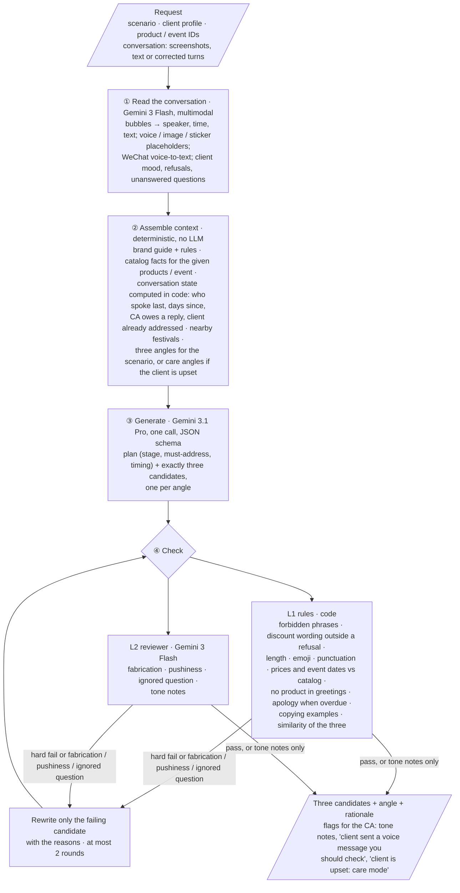
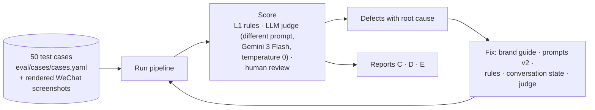

# Architecture

## 1. Deployment (Google Cloud)

| Component                   | Code                                                                             | Why it is there                                                                                                                                                                                                                                     |
| --------------------------- | -------------------------------------------------------------------------------- | --------------------------------------------------------------------------------------------------------------------------------------------------------------------------------------------------------------------------------------------------- |
| Web UI (`olvene-copilot`) | [`web/app.py`](../web/app.py), [`web/quota.py`](../web/quota.py)               | The CA's screen: client form or a test case, screenshot upload, editable parsed chat, three candidate cards with copy, flags and "use this one". Google sign-in plus per-user and global daily caps keep a public demo from running up Gemini costs |
| API (`huashu-api`)        | [`api/main.py`](../api/main.py)                                                 | Runs the pipeline. Private: only the web service account can call it. `/v1/parse` lets the CA correct the chat before generating                                                                                                                  |
| Eval job (`huashu-eval`)  | [`eval/run_eval.py`](../eval/run_eval.py), [`eval/judge.py`](../eval/judge.py) | Runs all 50 cases through the same pipeline, scores them with the judge, writes results to the mounted bucket                                                                                                                                       |
| Brand knowledge             | [`brand/`](../brand/)                                                           | Brand guide, machine-checkable rules, product and event catalog, festival calendar. Loaded by key into every request; no vector retrieval (total < 10k tokens, so nothing can be missed)                                                            |
| CI/CD                       | [`Dockerfile`](../Dockerfile), [`cloudbuild.yaml`](../cloudbuild.yaml)         | One image; the `ROLE` variable picks API, web or eval                                                                                                                                                                                             |

## 2. Pipeline (inside the API)

| Step          | Code                                                                                                                             | Design choice                                                                                                                                                                                                                   |
| ------------- | -------------------------------------------------------------------------------------------------------------------------------- | ------------------------------------------------------------------------------------------------------------------------------------------------------------------------------------------------------------------------------- |
| ① Read       | [`parse_screenshot.py`](../api/pipeline/parse_screenshot.py), prompt [`v2/parse_system.md`](../api/prompts/v2/parse_system.md) | A CA forwards screenshots, so the tool reads them. Result is shown in an editable table: a parsing mistake can be fixed before it spoils the drafts                                                                             |
| ② Context    | [`context.py`](../api/pipeline/context.py), [`dialog_state.py`](../api/pipeline/dialog_state.py)                               | Facts come only from the catalog, never from the model. Timing (who is waiting, for how long) is computed in code, because the model got date arithmetic wrong in v1                                                            |
| ③ Generate   | [`generate.py`](../api/pipeline/generate.py), prompts [`v2/generate_*.md`](../api/prompts/v2/)                                 | One call for all three, each with a fixed and different angle: diversity comes from strategy, not from sampling three times                                                                                                     |
| ④ Check      | [`guardrails.py`](../api/pipeline/guardrails.py), [`brand_rules.yaml`](../brand/brand_rules.yaml)                              | Red lines that can be checked by code are checked by code. The model reviewer covers what regexes cannot see. Only substantive problems trigger a rewrite, and only of the failing candidate, which keeps latency at about 40 s |
| Orchestration | [`run.py`](../api/pipeline/run.py)                                                                                              | Every response records model, prompt version and brand version, so each result can be traced to the exact configuration that produced it                                                                                        |

## 3. Evaluation loop

